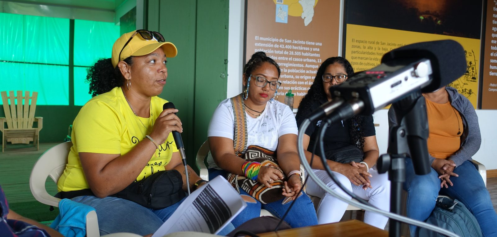

{width=100%}

::: {.callout-tip appearance="simple"}
## Key Takeaways

- Qualitative methods provide deep insights into human experiences, behaviors,
  and systems by focusing on narratives and contextual data rather than just
  numbers
- These methods complement quantitative research by helping design better
  interventions, understand local contexts, amplify marginalized voices, and
  evaluate program impacts
:::

## About qualitative research

Qualitative research methods are tools for exploring the how and why behind
human actions, decisions, and experiences. Unlike quantitative approaches, which
focus on numbers and statistical trends, qualitative methods delve into words,
narratives, and visual data to uncover rich, contextual insights. These methods
are particularly valuable for understanding the complexities of poverty and the
effectiveness of interventions.

Addressing poverty is about more than measuring income or access to resources;
it is about understanding the underlying social, cultural, and psychological
factors that perpetuate it. Qualitative methods help researchers:

- **Understand Context**: Explore how local norms, values, and practices
  influence the impact of programs.
- **Amplify Voices**: Capture the perspectives of marginalized groups who are
  often overlooked in traditional studies.
- **Design Better Interventions**: Use insights to tailor programs that meet the
  specific needs of target populations.
- **Evaluate Impact**: Unpack the mechanisms behind why interventions succeed or
  fail.

::: {.callout-tip}
## Qualitative research at IPA

At IPA, qualitative research plays a vital role in designing, implementing, and
evaluating programs aimed at reducing poverty. Here are some examples:

- **Financial Inclusion Studies**: Interviews and focus groups with low-income
  individuals to understand barriers to saving, borrowing, and using financial
  products.
- **Education Interventions**: Ethnographic studies in schools to explore
  teacher-student dynamics and identify strategies to improve learning outcomes.
- **Health Programs**: In-depth interviews with caregivers and healthcare
  workers to assess the cultural acceptability of new health interventions.
- **Gender Dynamics**: Case studies to explore how social norms and power
  structures affect women's participation in economic programs.
:::

Qualitative research does not stand alone---it complements quantitative methods
to create a more holistic understanding. For example, qualitative data can
explain anomalies in survey results, uncover mechanisms of change in randomized
controlled trials or RCTs, and provide actionable insights for scaling
successful programs.

### What makes qualitative research rigorous

Qualitative research is a rigorous, systematic approach, not an informal way of
collecting opinions. Its quality is judged by four criteria:[^johnson]

- **Credibility:** interpretations of participants' accounts are plausible,
  supported by triangulation, multiple accounts, and rich description.
- **Transferability:** readers have enough context to judge whether findings
  apply in other settings.
- **Dependability:** sampling, data collection, and analysis can be followed and
  evaluated by others.
- **Confirmability:** interpretations are clearly grounded in the data, through
  chains of evidence and audit trails.

See [Qualitative Data Quality and Analysis](qualitative-analysis.qmd) for how to
build these into your work. Rigor also depends on the skills of the people
collecting and interpreting the data; see [Competencies for Qualitative
Researchers](researcher-competencies.qmd).

::: {.callout-note}
## Common misconceptions

- **"It's easy and anyone can do it."** Qualitative research requires distinct
  technical and interpersonal skills and experience. High-quality findings come
  from systematic procedures grounded in established methods.
- **"Qualitative methods are just interviews and focus groups."** These are
  common, but they are only part of a broader toolkit.
- **"Small samples are not rigorous."** Qualitative research does not aim for
  statistical representativeness. Its rigor comes from rich description,
  repeated data collection over time, and the use of multiple methods.
- **"Decision-makers respond only to numbers."** Detailed qualitative accounts
  carry contextual weight. Policymakers value hearing from real people and
  understanding the practical challenges of implementation.
:::

### Choosing a method

Methods should follow questions, not the other way around. Questions about
frequency, scale, or prevalence usually need quantitative methods. Questions
about meaning, experience, mechanisms, or context need qualitative methods. Many
program questions benefit from mixed methods. For example, a survey can measure
how often children play and their wellbeing scores, while drawing or
photo-elicitation sessions explore how children experience play and why it
matters to them.

@tbl-method-selection compares six common qualitative methods.

  | Criteria                             | Interviews                      | Focus groups          | Observation           | Case studies            | Document analysis                   | After action review   |
  | ----------                           | ------------                    | --------------        | -------------         | --------------          | -------------------                 | --------------------- |
  | **Best for**                         | Individual depth                | Group dynamics        | Actual behaviors      | Comparison across cases | Historical or official records      | Recent learning       |
  | **Unit of analysis**                 | Individual                      | Group                 | Individual or setting | Program or site         | Organization                        | Activity or event     |
  | **Type of information**              | Personal or expert perspectives | Multiple perspectives | Behaviors             | Comparative             | Existing organizational information | Lessons learned       |
  | **Suitability for sensitive topics** | High                            | Medium                | Medium to low         | Varies                  | Low                                 | Medium                |
  | **Resources needed**                 | High                            | Medium                | High                  | High                    | Low                                 | Low                   |

  : Comparing qualitative methods {#tbl-method-selection} {.striped}

Three methods in the table do not have their own page:

- **Case study:** an in-depth examination of one program, site, or situation
  through several sources, such as observations, interviews, and records. Use it
  to understand how something works in practice or to draw lessons from a
  success or failure.
- **Document analysis:** a systematic review of existing documents such as
  reports, records, training materials, and protocols. Use it to gain historical
  or organizational context before fieldwork, or to triangulate other sources
  without collecting new data.
- **After action review:** a structured reflection after an activity or program
  cycle on what happened, why, what went well, and what to change. Use it to
  capture lessons while they are fresh and to support rapid iteration.

Common mistakes in choosing methods include defaulting to familiar methods,
choosing for convenience rather than fit, using the same approach for every
question, and considering resource constraints too late. Combining methods and
triangulating across them usually gives a more credible answer than any single
method. For example, to understand why some families drop out of a program
early, a team might interview families who dropped out, analyze attendance
records for patterns, hold focus groups with families who completed the program,
and run after action reviews with facilitators.

[^johnson]: Johnson, Jessica L., Donna Adkins, and Sheila Chauvin. 2020. "A
    Review of the Quality Indicators of Rigor in Qualitative Research."
    *American Journal of Pharmaceutical Education* 84 (1): 7120.
    <https://doi.org/10.5688/ajpe7120>

::: {.popup-image}
{.popup width=75%}
:::

## A Toolkit of Qualitative Methods

By incorporating qualitative methods in research, IPA ensures that programs are
not only evidence-based but also rooted in the realities of the people served.
These methods help design innovative solutions, evaluate their effectiveness,
and contribute to a world free of poverty.

::: {.callout-tip}
## **Focus Groups**

Focus groups involve guided discussions with a small group of participants to
explore their perceptions, opinions, and attitudes towards a specific topic.
This method is useful for generating diverse perspectives and understanding
group dynamics. → [Learn more about focus groups](focus-groups.qmd)
:::

::: {.callout-tip}
## **Qualitative Interviews**

Interviews involve one-on-one conversations between a researcher and a
participant to explore individual experiences, beliefs, and motivations. This
method allows for deep, personal insights and is flexible in terms of structure
and depth. [→ Learn more about qualitative interviews](interviews.qmd).
:::

::: {.callout-tip}
## **Observations**

Observational research involves systematically watching and recording behaviors
and interactions in their natural settings. This method provides insights into
real-world practices and social interactions that other methods might not
capture. [→ Learn more about observations](observations.qmd).
:::

::: {.callout-tip}
## **Rapid Ethnographies**

Rapid ethnographies are short-term, intensive studies that use ethnographic
techniques to gather in-depth information about a community or organization.
This method is particularly useful for understanding cultural contexts and
identifying key issues in a limited time. [→ Learn more about rapid
ethnographies](ethnographies.qmd).
:::

::: {.callout-tip}
## **AI-Assisted Qualitative Coding**

Large language models and embedding-based techniques can serve as a systematic
additional review layer in the qualitative coding process. This guide covers how
to use IPA's open source toolkit to apply predefined codebooks, identify
emergent themes, code behavioral cues, and validate model reliability. [→ Learn
more about AI-assisted qualitative coding](ai-assisted-coding.qmd).
:::
