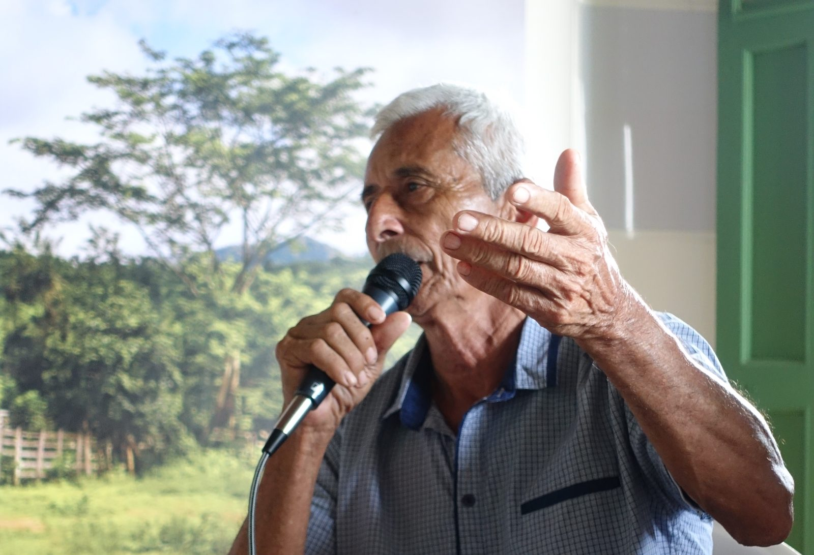
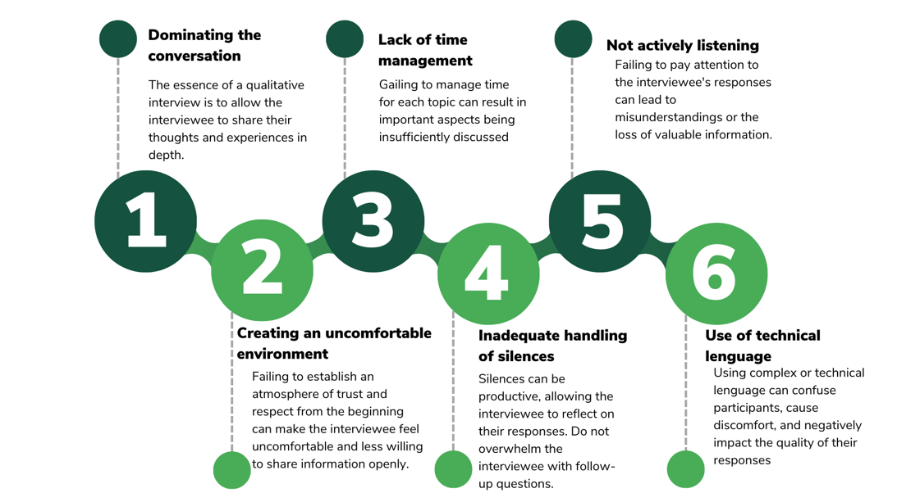

{width=80%}

::: {.callout-tip appearance="simple"}
## Key Takeaways

- Qualitative interviews use structured dialog where an interviewer guides the
  conversation to gather in-depth information about feelings, opinions, and
  experiences from interviewees.
- The success of qualitative interviews depends on the interviewer's skills in
  building rapport, active listening, and managing challenges.
:::

## What are qualitative interviews?

Interviews are a qualitative method of gathering information through a formal
dialog between two people---the interviewer and the interviewee---guided by a
specific research goal. Unlike conventional conversations, which involve
symmetrical communication and relationship between the interlocutors[^1], a
**qualitative interview** uses a structured approach. In this setting, the
interviewee permits the interviewer to direct the conversation and guide the
dialog in accordance with the objectives of the study. The interviewee thus
becomes the primary source of information.[^2]

This collection method offers flexibility. While there is a script or a list of
specific topics to investigate, the interviewer may follow emerging topics or
delve deeper into particular aspects according to the interviewee's answers. The
structure of this data collection technique can vary widely. At one end of the
spectrum are **highly structured interviews**, which follow a defined sequence
of topics and number of questions. At the other end are **semi-structured
interviews**, where the moderator intuitively delves into the topics of
interest.[^3] The research objectives and the type of data needed influence the
structure of the interview.

::: {.callout-tip}
## Data from qualitative interviews

Qualitative interviews seek in-depth answers and the person's interpretive
perspective. In general, interviews have some advantages for certain profiles in
contrast to focus groups. These include experts in different fields, populations
that experienced traumatic events, persons deprived of liberty, geographically
dispersed populations, and people with disabilities. Moreover, the types of data
gathered through interviews can include:

- **Feelings and Emotions:** Understanding the emotional responses and feelings
  of the interviewee. For example, *"How did you feel as you watched the
  children playing on their own?"*
- **Opinions and Perspectives:** Gaining insights into the interviewee's
  viewpoints and beliefs. For example, *"How do you view child wellbeing, and
  how has your background shaped that view?"*
- **Experiences and Narratives:** Collecting detailed accounts of the
  interviewee's personal experiences. For example, *"Walk me through a time when
  you tried a new activity with the children."*
- **Knowledge and Expertise:** Gathering information from experts or individuals
  with specialized knowledge. For example, *"Tell me how you prepare an activity
  so that it works well. What are the keys to doing it well?"*
:::

**In-depth interviews** help to learn about the interviewees' feelings,
opinions, perspectives, beliefs, and experiences. The interviewees express
themselves in their own words and in an active way, pointing out their point of
view on the issues raised by the interviewer. This collection method works well
for discussing complex or sensitive topics that some people may be reluctant to
discuss in a group setting.[^4] **Qualitative interviews** provide unique
insights from participants' experiences and knowledge, translated into detailed
narratives and descriptions that reveal how people interpret their experiences
and the world around them.

## Planning a qualitative interview

Proper preparation is essential for the success of an interview, ensuring that
the research activity meets its field data collection objectives. This section
provides detailed guidance on the planning steps that should be undertaken
before conducting an interview.

::: {.numbered-list}
(@) **Structure your team**
:::

During qualitative interviews, the fieldwork team includes a moderator and a
facilitator. The facilitator's participation is crucial to support logistical
and note-taking processes. While budget restrictions may sometimes require the
moderator to work individually. If you have a facilitator, it is important that
you identify the functions they will perform.

::: {.callout-warning}
### When not to have a facilitator

When an interview involves sensitive or personal issues, such as when the
interviewee is hesitant to share intimate details, the interviewer's approach
can significantly impact the conversation. For example, if a facilitator does
not value the importance of mental health, this may become evident in how they
take notes during an interview about traumatic experiences related to mental
health.
:::

::: {.numbered-list}
(@) **Recognize the skills of the field team**
:::

The quality of data produced during qualitative research activities relates to
the skills of the moderator and facilitator.[^5] These competencies, outlined in
@tbl-skills-field, enable teams to recognize and adequately represent the
diversity within qualitative data.[^5] While these skills are typically
developed through years of study and practice, field teams often consist of
individuals from multidisciplinary backgrounds. These individuals have varying
levels of experience. Regardless of experience level, it is important to review
and discuss these skills with your team to identify possible gaps and
opportunities for improvement.

Currently, there are no standardized metrics to measure the prevalence of these
skills among qualitative fieldwork moderators. Therefore, teams should view the
skills in @tbl-skills-field as a resource for reference and reflection. Ensuring
that everyone on the team understands how these competencies contribute to
engaging with the population is essential for collecting high-quality
information.

  | Skill                          | Description                                                                                                                                                                                                                                                                                                        | Why is this skill relevant?                                                                                                                                                                                                                                                                                                                                             |
  | ------------------------------ | ------------------------------------------------------------------------------------------------------------------------------------------------------------------------------------------------------------------------------------------------------------------------------------------------------------------ | ----------------------------------------------------------------------------------------------------------------------------------------------------------------------------------------------------------------------------------------------------------------------------------------------------------------------------------------------------------------------- |
  | Cognitive empathy              | The field team's ability to understand and communicate participants' situations from their perspectives, understanding how they see the world and their roles within it.                                                                                                                                           | Allows researchers to connect with participant's realities and experiences. Helps to create a relationship of trust and respect with the participants. Seeks to avoid generalizations and stereotypes that may arise from preconceptions or external influences such as previous studies. Enhances understanding of participants' situations without resorting to pity. |
  | Follow-up                      | The field team's ability to recognize when additional information is needed to answer the questions initially posed and those that arise during the research process. This ability implies curiosity and a willingness to explore new issues or doubts that emerge as data collection progresses.                  | Increases the quality and robustness of data by allowing a more detailed exploration of the studied phenomenon. Contributes to obtaining deeper responses from participants. Enables exploration of emerging themes during data collection. Helps detect and validate patterns observed in the field.                                                                   |
  | Self-awareness and reflexivity | The field team's ability to continuously reflect on how their presence, background, and assumptions influence data collection, interpretation, and analysis. This ongoing self-reflection ensures that the qualitative field team is mindful of its impact on the research process and the participants.           | Helps maintain ethics in the researcher-participant relationship. Facilitates understanding of personal limitations in connecting with participants. Aids in developing strategies to overcome communication barriers and create an environment where participants feel comfortable sharing sensitive information.                                                      |
  | Heterogeneity*                 | The field team's ability to represent and reflect the diversity within the group being studied. This skill involves recognizing and documenting the differences and variations among individuals or subgroups during qualitative research, typically applied during the data analysis phase.                       | Contributes to challenging generalized and simplistic patterns. Ensures that data reflect both common and atypical experiences. Demonstrates the field team's ability to identify, recognize, and document heterogeneity in the population studied.                                                                                                                     |
  | Palpability                    | The field team's ability to provide detailed descriptions in their field notes or diaries, making the data tangible and clear. This involves avoiding abstract descriptions and, instead, offering vivid accounts that allow the research team to visualize and understand participants' experiences and contexts. | Reliable findings are supported by specific details that depict the events and situations studied. Helps to avoid abstraction in the data, grounding conclusions in concrete evidence.                                                                                                                                                                                  |

  : Skills of the field team conducting interviews {#tbl-skills-field}
    {.striped}

::: {.numbered-list}
(@) **Plan logistics activities**
:::

Logistical activities play a crucial role in the success of interviews. Careful
planning ensures that all necessary elements are in place to conduct interviews
effectively. The following list presents general activities that should happen
before implementing interviews. However, this list could be more comprehensive
based on the specific research needs of the fieldwork. Ensure you cover all
critical aspects to complete your research activities successfully. Based on
experience in qualitative field operations across various contexts, the IPA team
has identified key practices that guide research teams in effective planning:

::: {.callout-tip collapse="true"}
## Schedule Participants

Schedule interviews at least one week in advance. Send reminders before the
activity.

During scheduling, tell participants about the objective, scope, leading
organization, and confidentiality of the interview to align expectations and
avoid confusion.
:::

::: {.callout-tip collapse="true"}
## Verify the location of the Interview

Verify the location and conditions of the meeting site. Remember that it is
important to schedule a place whose location does not pose a risk to the
participant or the team.

This place should have appropriate seating and furniture so the participant
feels comfortable during the interview.
:::

::: {.callout-tip collapse="true"}
## Prepare essential materials

Ensure you have all the necessary materials for the session. This includes
incentives, refreshments/snacks, attendance sheet, recording equipment, and
batteries.

Test the audio equipment in advance to ensure clear recording of the interview.
:::

::: {.callout-tip collapse="true"}
## Review the strategies for taking notes

Have a note-taking strategy to identify topics not recorded in the audio,
capture nonverbal communication from the participant, and document the session
in case the participant does not consent to recording. The facilitator supports
this task.
:::

::: {.callout-tip collapse="true"}
## Write a field protocol and train interviewers

Write a protocol that tells interviewers what to do, when, how, and why.
Explaining the *why* matters most: field teams have to make decisions on their
own, and understanding the reasons behind a protocol helps them decide well. Use
checklists so that interviewers follow every step.

Train interviewers until they understand what the protocol expects, have
mastered the script (its logic, flow, and the data each question aims to
collect), and can deliver it responsively. Discussion helps, but practice with
realistic scenarios such as role plays is the core of good training. See [Field
Staff Training](/data-collection/fieldwork-management/field-staff-training.qmd)
for more guidance.
:::

::: {.numbered-list}
(@) **Design and study the script**
:::

Understanding the research questions is crucial for effective interviewing. The
script is a guiding tool that helps keep the conversation within the research
objectives. However, each dialog is unique, so it's important to study the
script to adapt to the conversation's context without losing sight of the main
topics.

During the script preparation, identify the main questions that address the
research objectives, and plan how you will go deeper with questions that unpack
and verify what the participant says.[^6] Research literature often calls these
*follow-up* and *probing* questions. This guide uses *unpack* and *verify*
because, in practice, people use "probing" for both, and the difference matters:
unpacking asks the participant to **expand**, while verifying asks them to
**confirm** your understanding.

- **Main questions:** Wide, general, and open-ended. They come from the script
  and start each topic. They place no limit on the range or length of responses
  and let the participant explain their position, feelings, or experiences
  without being led.

  - *Tell me about what play looks like in your home.*
  - *Can you walk me through a typical session with the children?*

- **Questions that unpack a detail:** Semi-open questions that get more detail
  on topics of interest raised in the answer to a main question. Plan some in
  advance, and expect to improvise others.

  - Experiences: *Walk me through that. What stood out to you?*
  - Emotions: *What did it feel like when you did that?*
  - Root causes: *Why do you think that was?*
  - *What do you think would happen if [situation]?*
  - *How did you decide to do it that way?*

- **Questions that clarify, verify, or define:** Check that you understand the
  participant's meaning, not your interpretation of it. These are often
  unplanned and respond to the conversation. Verifying is how you practice
  cognitive empathy, and questions about what a word means to someone can open
  deep conversations.

  - Define: *You said "independent." What does that mean to you?*
  - Verify: *You are saying first [X], then [Y]. Is that correct?*
  - Make concrete: *Can you give me an example of that?*

- **Closed questions:** Avoid them. A yes-or-no question ends the thread before
  the participant has shown you anything worth exploring.

Understanding the research goals and main questions lets you go beyond the
script and explore dimensions of the problem that were not initially known.

### Word questions carefully

Small wording choices can push participants toward an answer. Review every
question in the script for these three problems:

  | Problem             | What it is                                                                                                                                             | Weak question                                                                             | Stronger question                                                                                                           |
  | ---------           | ------------                                                                                                                                           | ---------------                                                                           | -------------------                                                                                                         |
  | **Double-barreled** | Two concepts combined so that they must be answered together. You get one answer to two questions and may not know which one the participant answered. | *How do you help children get along with one another and express themselves during play?* | Ask separately: *How do you help children get along with one another?* Then: *How do you help children express themselves?* |
  | **Leading**         | Guides or pushes the participant toward a particular answer.                                                                                           | *How has our program improved children's mental health?*                                  | *What changes, if any, good or bad, have you noticed since the program started?*                                            |
  | **Loaded**          | Contains charged or positive-sounding terms that hint at the expected response.                                                                        | *What do you think about the new, innovative methods you learned?*                        | *What do you think about the methods you learned in the training?*                                                          |

  : Common question wording problems {#tbl-question-wording} {.striped}

Leading and loaded questions are hard to spot because they sit in your blind
spots. To find them:

- Reflect on your own positionality and assumptions about the program.
- Ask a colleague to review the wording.
- Ask an AI tool to flag leading questions. It is less reliable for loaded terms
  that depend on local meaning.
- Watch for program buzzwords. Participants quickly learn the words a program
  uses and may agree with anything that contains them. If you suspect a term is
  loaded, ask the same question with and without it and compare the answers.

### Test the script before fieldwork

Testing with real people is the only way to know whether a script works:

1. **Bench test:** Review and test the script internally before any contact with
   participants, for example through role plays with field staff. Focus on
   clarity, bias, and flow. See [Bench
   Testing](/data-quality/bench-testing.qmd).
2. **Pilot:** Interview a small number of people from the target population,
   such as four or five, and assess interviewer skill, participant
   understanding, and the quality of responses. See [Pilot
   Survey](/data-quality/pilot-survey.qmd).
3. **Soft launch:** Start data collection at one or two sites with close
   oversight to work out problems with the full implementation before scaling
   up.

## Conducting a qualitative interview

To begin the interview, always start by introducing yourself and the objective
of the session. Read the informed consent form. Ensure that the interviewee
understands the purpose of the activity, its confidentiality, and the potential
risks and benefits of participating in it. Use simple words that the interviewee
understands.

Then, emphasize the data security measures your team is taking to keep the
information confidential. This will help the interviewee feel confident that
they can discuss their experiences and will be heard.

Create a comfortable and calm atmosphere. Throughout the activity, it is
essential to maintain this atmosphere that allows the interviewee's opinions to
be spontaneous.

::: {.callout-note}
### Role of the facilitator in this phase

- Ensure that recording equipment is working throughout the activity.
- Ask counter-questions to the interviewee.
- Verify that no relevant topics are left out.
- Assist if the interviewee's emotions prevent them from continuing with the
  interview. For example, in actions such as offering a glass of water or
  proposing a pause.
- Take notes of the entire activity, especially the interviewee's nonverbal
  reactions.
- Support the moderator in time management.
:::

### Being an effective interviewer?

The interviewer guides the discussion and ensures the flow of the dialog with
the interviewee while focusing on the relevant issues. An effective interviewer
not only facilitates a natural discussion, but also creates an environment where
the participant feels comfortable and safe expressing their opinions openly,
without fear of criticism or judgment. @tbl-skills-interviewer presents skills
of effective qualitative interviewers.

  | Skill                                | Description                                                                                                                                                | Why is this skill relevant?                                                                                                                                               |
  | ------------------------------------ | ---------------------------------------------------------------------------------------------------------------------------------------------------------- | ------------------------------------------------------------------------------------------------------------------------------------------------------------------------- |
  | Provide for participants' well-being | Create safe and comfortable environment. Prioritize interviewee's well-being, respect and value. Adapt environment and rhythm to reduce stress/discomfort. | Helps establish trust and encourages open dialog. Shows respect for participant's comfort and dignity. Body language that promotes trust is essential.                    |
  | Be empathetic                        | Express empathy and validate interviewee's emotions to create atmosphere of openness and sincerity. Practice effective communication.                      | Creates atmosphere of trust. Helps interview flow well. Express gratitude for participation. Match facial expressions and tone to emotions shared.                        |
  | Use few interruptions                | Avoid abrupt interruptions. Guide conversation back on track subtly when needed. Let interviewee establish narrative order.                                | Respects participant as main source of information. Allows natural flow of conversation while maintaining focus. Can use techniques like paraphrasing to redirect gently. |
  | Listen actively[^7]                  | Show full attention and interest. Consider both verbal and nonverbal communication. Ask thoughtful follow-up questions.                                    | Demonstrates respect and engagement. Helps ensure accurate understanding. Allows deeper exploration of topics through appropriate follow-up.                              |
  | Avoid value judgments                | Maintain neutral, inquiring stance. Don't express agreement/disagreement that could influence responses.                                                   | Prevents biasing responses. Keeps focus on participant's perspective. Use neutral phrases to encourage elaboration.                                                       |
  | Train your memory                    | Develop ability to remember key details for meaningful connections during conversation.                                                                    | Enables better follow-up questions. Helps maintain conversation flow. Allows tracking of important themes.                                                                |
  | Use silences constructively          | Handle silences constructively to allow reflection time. Avoid filling silence with filler words.                                                          | Gives participants time to think. Shows respect for responses. Allows natural pace of conversation.                                                                       |

  : Desirable skills of an interviewer {#tbl-skills-interviewer} {.striped}

#### Manage the emotional flow

How you respond to what participants say shapes how much they are willing to
share. Use these techniques:

  | Technique                                 | Guidance                                                                                                                 | Example phrase                                                                                                        |
  | -----------                               | ----------                                                                                                               | ----------------                                                                                                      |
  | Convey attention and openness             | Use words and body language that invite the participant to share more, without leading them.                             | *"Tell me more about that perspective."*                                                                              |
  | Listen to their logic and reflect it back | Reflect back, and verify, how they explain their views, values, and experiences.                                         | *"What I'm hearing is that your main concern was [X]."*                                                               |
  | Recognize their emotion                   | Acknowledge the emotion as the participant's own, not yours or other people's.                                           | Use: *"I can hear the frustration in your voice."* Avoid: *"I feel so bad for you!"* or *"Teachers have it so hard!"* |
  | Avoid generalizations and stereotypes     | When you hear a broad claim, ask who, when, and whether it is true for everyone. Apply this to your own assumptions too. | *"You said they don't care about their health. Who exactly do you mean? Is that true all the time?"*                  |
  | Watch for red flags                       | Fatigue, anger, or despair signal that the interview may need to pause.                                                  | *"I can see this is frustrating. Would you like to take a break or finish another time?"*                             |

  : Techniques for managing emotional flow {#tbl-emotional-flow} {.striped}

#### Manage the information flow

While listening, keep track of what you still need to learn:

- **Track question completion in your head.** Know which topics you have covered
  and which remain, so you can prioritize when time or energy runs short.
- **Be silent.** Wait and listen. A few seconds of silence often gives the
  participant time to think and continue.
- **Probe differences and incomplete responses.** Notice answers that contradict
  earlier statements or stop short, and return to them.
- **Don't assume concepts are universal.** Words like "adapt," "political," or
  "independent" may mean something different to the participant than to you.
  Ask.
- **Know when to bring it back or move on.** Redirect a conversation that has
  drifted, or skip lower-priority questions when the participant is tiring.

::: {.callout-note collapse="true"}
## Practice scenarios: Managing information flow

These illustrative scenarios show how the techniques work together. Judgment and
context always matter.

**A participant drifts into hearsay.** You ask a clinic coordinator about the
main challenges in getting play materials to the clinic. They say, "It's fine,
no real problems," then launch into a story about a neighbor's cousin who thinks
procurement is "all political."

*One strong option:* Bring the conversation back to their own experience first
and probe the incomplete answer. "You said things are going quite well. What
makes you say that? Can you walk me through what happens from ordering materials
to when they arrive?" Then return to the word "political": "You mentioned it's
all political. What do you mean by that?" The participant may describe delays
they first dismissed, grounding the earlier speculation in their own experience.

**A participant is tiring.** Forty minutes into an interview, a counselor who
has been thorough starts giving short answers, such as "We work with families
when needed," and rubs their temples.

*One strong option:* Wait a few seconds in case they are thinking. If they don't
continue, note that "when needed" is incomplete. Check which questions remain.
If a crucial question is still unanswered, move to it now and return to the
incomplete statement only if time allows. You may lose some questions, but you
use the participant's remaining energy on what matters most.

**A participant trails off.** A program facilitator explaining how they
structure sessions says, "There's this one approach we were trained on, but
honestly most of us have kind of adapted it because..." and looks at you.

*One strong option:* Stay silent; they are working through something. Then
verify what "adapted" means to them, and return to the original question about
how they structure sessions, which they have not fully answered.
:::

### Potential challenges in a qualitative interview

There are situations that could take place during a qualitative interview that
you should prepare for. Here are some examples:

::: {.callout-warning collapse="true"}
## **Incomplete, superficial or monosyllabic responses**

In some interviews, particularly at the beginning, the interviewee may be shy or
inhibited, which prevents them from providing detailed and in-depth answers to
the questions posed. To identify an incomplete or superficial response, you can
look for aspects such as:

- answers that are too general and do not provide specific details
- answers that are limited to one or a few words
- haste in answering without going into detail.

Invest time at the beginning of the activity to build rapport with the
interviewee before addressing more in-depth questions. This initial trust may
encourage fuller responses. You can use "icebreaker" activities to do this. Ask
open-ended questions that require a more elaborate response and prepare
follow-up questions to provide more details on initial responses. Ask for
clarification by using counter-questions like "How did you feel about this?" or
"What was your reaction when this happened?" to encourage more detailed answers.
Explain how your answers make a valuable contribution to the study or project.
Ask easy-to-understand questions in simple language and rephrase some if
necessary.
:::

::: {.callout-warning collapse="true"}
## **Emotional overflow from participants**

Participants may experience intense emotions during an interview, which can be
challenging to manage due to the personal nature of discussions. Be empathetic
and avoid abrupt changes in discussion topics during emotionally charged
moments. Allow participants to express their emotions while guiding the
discussion constructively. Offer the option to pause or continue based on the
participant's comfort. If emotions are overwhelming, take a short break and show
support. Provide relevant mental health care information per research protocols.
Ensure the field team has training in psychological first aid if sensitive
issues will be discussed.
:::

::: {.callout-warning collapse="true"}
## **Fatigue**

Fatigue can affect both the interviewee and interviewer, leading to a loss of
concentration, energy, and quality in responses. This may result in missed
questions or premature assumptions. Limit the interview length and be flexible
with scheduling if you notice signs of fatigue. Ensure the interview environment
is comfortable, with good lighting and low noise. Schedule breaks during the
interview if necessary, or continue at another time if needed. Consider active
breaks or refreshments to help rejuvenate participants.
:::

::: {.callout-warning collapse="true"}
## **Deviation from the central theme**

Conversations may deviate from the interview's objectives, requiring the
moderator to tactfully redirect the discussion while balancing the exploration
of valuable but off-topic insights. Direct the conversation subtly and without
abruptly interrupting the interviewee to return to the main topic. Establish
clear objectives at the beginning. Before starting the interview, explain the
objectives and topics to be covered so that the interviewee is clear about the
necessary focus.
:::

::: {.callout-warning collapse="true"}
## **Hostile interviewee**

An interviewee may dominate the conversation with aggressive or derogatory
language, creating a tense atmosphere. Prepare some key concepts about the topic
that can help you respond confidently to the interviewee's objections or
challenges. In the event of verbal or other kind of aggression, end the
interview, thanking the participant for their time.
:::

### Common interview mistakes

When conducting qualitative interviews, avoid some mistakes so that the research
activity, objectives, and the integrity of the person being interviewed are
protected. Some mistakes are described here:

{width=100%}

## After the interview

The interview concludes when the interviewer determines that all the topics
outlined in the script have been covered or if the interviewee indicates that
the session should end due to time constraints or emotional reasons. To wrap up
the working session, it is recommended to:

- Provide space for reflection in which the interviewee can express comments,
  suggestions, or questions about the discussion
- Express gratitude to the participants for their time and willingness to
  participate, emphasizing the importance of their opinions and the information
  they provided to the study
- Secure the data by prioritizing the safe storage of the recording and notes
  from the session.

It is also important to start working on the interview notes as soon as possible
once it has been completed because if too much time passes between field
activities and developing analysis, there is a risk of accumulating information
and losing the opportunity to enrich the study research team insights.

### Document Research Activities

At the end of the interview, it is important to document the information
obtained in detail. How this documentation is done is a decision linked to the
research design and researchers determine this before fieldwork begins. Examples
of products you can use for this purpose are:

- Full transcripts of the discussions
- Detailed notes taken during the research activity
- Field notes
- Field diaries

::: {.callout-note}
### Remember

The lack of initial documentation products risks all information processing
components and, thus, the quality of the data obtained.
:::

Information should be recorded as soon as the interview concludes, to prevent
the loss of crucial details. This immediate action is vital to the research
process. In addition, the products derived from the focus group must follow
information storage protocols, which may include anonymization and encryption to
avoid compromising the confidentiality of participants.

### Follow a documentation timeline

Accurate data depends on acting quickly after each interview.[^4] Transcription
can wait; documentation and quality checks cannot.

- **Within 24 hours:** Complete the interview documentation.
  - Expand shorthand notes into a full narrative, including observations.
  - Complete the data collection checklist and report any missing elements.
  - Number and store files following your data security protocol. Do not delete
    any audio, back up data where possible, lock physical materials, and load
    and encrypt digital files.
- **Within 48 hours:** Run quality checks and act on what they find.

### Transcribe accurately

- Anonymize data as early as possible.
- Write down everything in the audio exactly as said, including filler words
  such as "umm," "ok," and "yeah."
- Mark unintelligible words and sounds.
- Note silences, pauses, and actions. For example: *"It was a very difficult
  situation for me (long pause). I don't like to talk about that these days
  (starts to cry)."*
- Check completeness daily, and have a second person transcribe sample sections
  so you can compare the two versions.

If you use software or AI tools for transcription, test their accuracy on a
small sample of your own data first. Accuracy varies by language, accent, and
recording quality.

### Control interview and transcript quality

Apply more quality control early in data collection, when problems are easiest
to fix, and reduce it as the team proves reliable:

  | Quality control                                                  | Main idea                                                | Timing                                       |
  | -----------------                                                | -----------                                              | --------                                     |
  | Practical training                                               | Give the team practice with realistic scenarios          | Before fieldwork, with discussion throughout |
  | Soft launch and spot checks                                      | Observe interviewing and transcription as they happen    | First one or two weeks                       |
  | [High-frequency checks](/data-quality/high-frequency-checks.qmd) | Check interviews and transcripts for missing information | Continuously, daily or every other day       |
  | [Backchecks](/data-quality/backchecks.qmd)                       | Re-interview or re-transcribe short sections and compare | Frequent at the start, then less often       |

  : Quality controls for interviews and transcripts {#tbl-interview-qc}
    {.striped}

For guidance on analyzing interview data, see [Qualitative Data Quality and
Analysis](qualitative-analysis.qmd).

## Online interviews

Remote interviews through a digital platform such as meets, Zoom, or telephone
are an alternative when face-to-face interviews are not feasible due to
distance, time, and budget constraints or when the interviewee prefers a remote
setting. These interviews are beneficial for connecting participants from
distant geographic locations or those who cannot attend in person, while also
providing a safe and discrete environment. However, remote settings come with
specific challenges that must be considered.

  | Challenges                                 | Description                                                                                                                                                                                                                  | Possible solutions                                                                                                                                                                                                                                                                                    |
  | ------------------------------------------ | ---------------------------------------------------------------------------------------------------------------------------------------------------------------------------------------------------------------------------- | ----------------------------------------------------------------------------------------------------------------------------------------------------------------------------------------------------------------------------------------------------------------------------------------------------- |
  | **Building trust and empathy**             | In remote interviews it is often more difficult to establish trust.                                                                                                                                                          | Invest time in the initial conversation to establish a personal connection. Be expressive and attentive to compensate for the lack of more subtle nonverbal cues. Avoid distractions that may be present. In the case of virtual interviews, ask the participant to use a camera during the activity. |
  | **Connectivity problems**                  | Connectivity problems include situations that may cause people to interrupt their participation in the interview.                                                                                                            | During the scheduling, validate the participants' connection difficulties; if they require it, make internet recharges. Avoid that the research activity generates connectivity costs for the participants. If necessary, consider interviewing in person.                                            |
  | **Fatigue due to constant use of screens** | Fatigue associated with prolonged screen use or time on the phone can affect the concentration of both the interviewer and the interviewee.                                                                                  | Plan breaks during lengthy interviews. Limit the duration of each session to a reasonable time, approximately one hour. Plan several sessions if necessary.                                                                                                                                           |
  | **Users multitasking**                     | The person being interviewed may perform other tasks while participating. This may affect their participation in the activity.                                                                                               | Suggest that the interviewee have their camera turned on. During scheduling, remember that the interview is an activity that involves full attention to listening to others, and engagement with the questions.                                                                                       |
  | **Confidentiality**                        | Some interviewees may carry out the activity in spaces shared with family members and acquaintances. Depending on the sensitivity of the topics, this situation may place participants in uncomfortable or risky situations. | Advise interviewees on how to select an ideal space to have the interview. Inform the participant when the recording starts, pauses or stops.                                                                                                                                                         |

  : Considerations and challenges in virtual interviews {#tbl-online-interviews}
    {.striped}

## A Practical Guide for Conducting Interviews

The content in this resource adapts from IPA Colombia's *"Practical Guide for
Conducting Qualitative Interviews"*. This practical guide provides some tools to
conduct qualitative fieldwork through interviews. However, it is essential to
note that data collection is one of the first steps in the process. After data
collection, a necessary process of analyzing the information collected follows.
This analysis allows the results to be interpreted and understood in depth,
facilitating the identification of patterns, themes, and meanings crucial for
qualitative research.

<object data="/assets/files/Version 1.0_Interviews.pdf" type="application/pdf" width="100%" height="600px">
    
Unable to display PDF file. <a href="/assets/files/Version 1.0_Interviews.pdf">Download</a> instead.

</object>

[^1]: Ruiz, A. (n.d.). Entrevista cualitativa: la conversación como forma de
    acceso al conocimiento [Paper presentation]. II Jornada de Investigación en
    Disciplines Artísticas y Proyectuales.
    http://sedici.unlp.edu.ar/handle/10915/39236

[^2]: López, R., & Deslauriers, J. P. (2011). The qualitative interview as a
    means of research in Social Work. Márgen, (61).

[^3]: Ryan, F., Coughlan, M., & Cronin, P. (2009). Interviewing in qualitative
    research: The one-to-one interview. International Journal of Therapy and
    Rehabilitation, 16. https://doi.org/10.12968/ijtr.2009.16.6.42433

[^4]: Mack, N., Woodsong, C., MacQueen, K. M., Guest, G., & Namey, E. (2005).
    Module 3 In-Depth Interviews. In Qualitative Research Methods: A Data
    Collector's Field Guide (pp. 29-50).

[^5]: Small, M. L., & Calarco, J. (2022). Qualitative Literacy: A guide to
    evaluating ethnography and interview research. University of California
    Press.

[^6]: Rubin, H. J., & Rubin, I. S. (2012). Structure of the responsive
    interview. In Qualitative Interviewing: The Art of Hearing Data (3rd ed.,
    pp. 115-129). SAGE Publications.

[^7]: Kvale, S. (2007). Conducting an interview. In Doing Interviews (pp.
    52-66). SAGE Publications.
