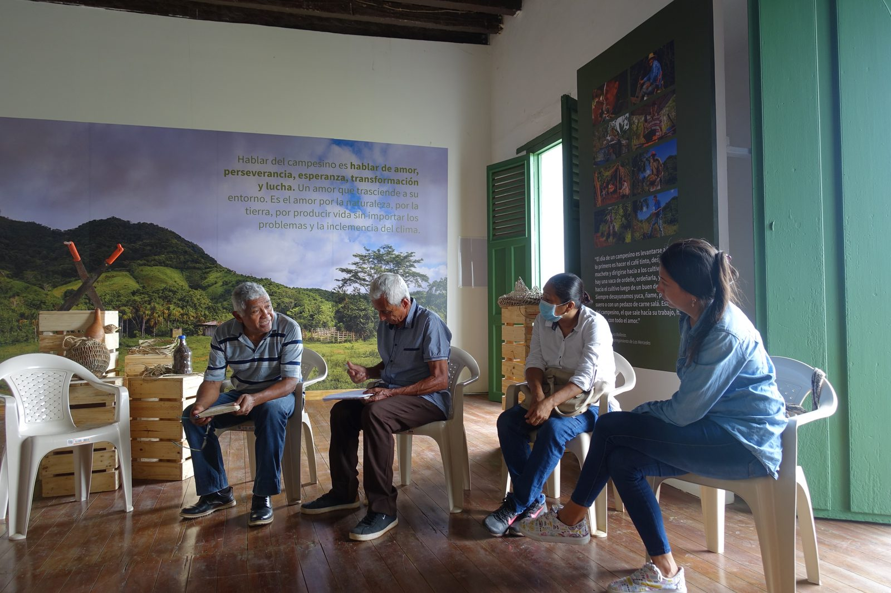

{width=80%}

::: {.callout-tip appearance="simple"}
## Key Takeaways

- Observations are a qualitative research technique that captures behaviors and
  interactions through the researcher's senses and interpretations, with two
  main approaches: participant observation -- where researchers actively engage --
  and non-participant observation -- where researchers observe without
  intervening.

- The success of observations depends on careful planning, including team
  structure, clear objectives, appropriate documentation methods, and
  consideration of potential challenges like participant distrust or data
  documentation difficulties.
:::

## What is an observation?

Observations are a qualitative research data collection technique that
identifies traits, behaviors, and interactions of individuals and their contexts
through the senses and interpretations of the researcher.[^1] The results of
observations typically include detailed descriptions of what the field
researcher observed, heard, and interpreted during research activities.
Observation is therefore a subjective data collection technique that relies on
observation, note-taking, and interpretation skills.[^2] Researchers can
classify observations as either participant or non-participant, depending on how
they conduct the fieldwork.

### Participant Observation

In participant observation, researchers actively participate and interact in
daily activities or specific contexts of the participants.[^3] This approach
allows researchers to gain first-hand understanding of participants' daily
practices, perspectives, and relationships. For example, a researcher might join
community leaders on journeys to identify transport needs for accessing a social
program.

### Non-Participant Observation

In non-participant observation, the researcher analyzes the behavior and
relationships of participants without intervening, or intervening as little as
possible, in the context or activity. Observers position themselves in a
suitable place to listen and observe interactions without making comments or
participating. For example, a researcher might conduct asynchronous remote
observations through video recordings to identify how public school teachers
reinforce gender stereotypes among students.

### What observations can and cannot capture

The value of observation is direct access to behavior rather than self-reports.
Observations capture actions, reactions, and interactions. Some decisions and
feelings are observable too. Observations cannot capture the thoughts,
intentions, reasons, or explanations behind what you see.[^7]

Observations are also subjective, even when you quantify the results. Observers
choose what to focus on, because they cannot write down everything. They
interpret body language, tone, and meaning. And their presence affects what
people do and how the observer sees it.

To fill these gaps, pair observations with other data:

- **Quick survey:** for example, ask how many children were absent and their
  ages.
- **Interview:** ask the person observed to explain what happened.
- **Focus group:** ask participants what an activity means to them.
- **Document review:** look at a lesson plan or session plan.
- **Administrative data:** merge information about the site to compare across
  groups.

## Unstructured vs. structured observations

In both participant and non-participant observations, the level of data
structuring varies based on the fieldwork approach and the expected research
outcomes:

### Unstructured Observations

Unstructured observations use open-ended questions in data collection
instruments to obtain highly descriptive and narrative information from the
researcher. For example, researchers mapping the challenges of caring for
children might attend a guided tour with facilitators who share their
experiences and suggest improvements to support children's well-being. This
approach is suitable in certain context described below in
@tbl-unstructured-obs.

  | **Context**                 | **Description**                                                                                                                                              |
  | --------------------------- | ------------------------------------------------------------------------------------------------------------------------------------------------------------ |
  | Exploratory Research        | When the research topic is relatively unknown or when exploring a phenomenon without preconceived notions or rigid frameworks.                               |
  | Complex or Dynamic Settings | In environments where behaviors or interactions are complex and unpredictable, allowing the observer to capture a wide range of activities and interactions. |
  | Contextual Understanding    | When aiming for a deep, holistic understanding of a setting, context, or culture without predefined categories.                                              |
  | Flexibility Required        | When the researcher needs flexibility to follow interesting leads or unexpected occurrences during observation.                                              |
  | Deep Immersion              | When deeply understanding the culture, practices, and perspectives of a group by experiencing them firsthand.                                                |
  | *Hidden Behaviors           | When certain behaviors or interactions are not visible to outsiders, requiring the researcher to become part of the group.                                   |
  | Building Trust              | When establishing trust and rapport with participants is essential for obtaining accurate data, best achieved through involvement.                           |
  | Sensitive Topics            | When studying sensitive or private behaviors that participants may not openly share with an outsider.                                                        |

  : When to consider unstructured observations [^4] {#tbl-unstructured-obs}
    {.striped}

### Structured Observations

Structured observations use closed-ended questions to obtain specific
information, resulting in short responses, counts, or responses on scales. For
example, researchers might conduct asynchronous observations of recordings to
identify how often teachers in public educational institutions reinforce gender
stereotypes among young children. As with unstructured observations, structured
ones are suitable in certain context described below in @tbl-structured-obs.

  | **Context**                  | **Description**                                                                                                                             |
  | ---------------------------- | ------------------------------------------------------------------------------------------------------------------------------------------- |
  | Focused Research             | When the research aims to collect specific, consistent, and comparable data across different settings or subjects.                          |
  | Quantifiable Data Needed     | When the researcher needs to quantify behaviors or interactions, making it easier to analyze and compare results.                           |
  | Predefined Variables         | When the study has clear research questions or hypotheses, and the researcher knows exactly what behaviors or events to observe and record. |
  | Consistency Across Observers | When multiple observers are involved, ensuring consistency in data collection to maintain reliability.                                      |
  | Objectivity                  | When maintaining a level of detachment is important to avoid influencing participants' behavior.                                            |
  | Ethical Concerns             | When participation might create ethical issues, such as situations where the researcher's involvement could affect the outcome.             |
  | Natural Behavior             | When observing natural, unaltered behavior is critical, and the presence of a participant observer might alter how people act.              |
  | Large Groups                 | When studying large groups or public behaviors where direct participation isn't feasible or necessary.                                      |
  | Comparative Studies          | When comparing behaviors across different groups or settings, requiring a consistent, detached observational stance.                        |

  : When to consider structured observations [^4] {#tbl-structured-obs}
    {.striped}

### Choosing Between Structured and Unstructured Approaches

Participant observations often align with an unstructured approach, as the
richness of these activities typically relies on the events, topics, and places
that emerge during fieldwork. In contrast, structured observations often align
with a non-participant approach, allowing research teams to standardize
observations and minimize interference with the context. The choice between
structured, unstructured, or mixed approaches depends on the specific needs of
the study and its research design. In practice, these approaches are not
mutually exclusive, and research teams can combine both during fieldwork.

Two common pairings illustrate the difference:

- **Participant and unstructured:** You walk with parents and children to a
  clinic to experience the obstacles they face in reaching care. Your notes are
  divided into three open sections: parent behaviors, child behaviors, and the
  environment.
- **Non-participant and structured:** You sit quietly at the back of a session
  and rate three core behaviors from a training program, so that you can compare
  how widely staff have adopted them across many sites.

## Match the observation to its purpose

Observation can serve three different purposes, and each needs a different
design:[^8]

  | Purpose                    | What it involves                                                                                                                   | Frequency                                 |
  | ---------                  | ------------------                                                                                                                 | -----------                               |
  | **Individual improvement** | A coach observes a staff member, such as a teacher, to identify strengths and weaknesses and tailor support.                       | Based on individual need, usually ongoing |
  | **Program improvement**    | A monitoring activity. A sample of staff is observed consistently to see whether key practices are happening, and at what quality. | Several learning cycles per year          |
  | **Program evaluation**     | Similar to program improvement, but with a control group, so that you can measure how much change the program caused.              | At the start and end of implementation    |

  : Purposes of observation {#tbl-obs-purposes} {.striped}

::: {.callout-warning}
## Don't combine coaching with monitoring

Combining coaching visits with monitoring observations looks efficient but
causes two problems. Coaching becomes less effective, because coaches spend time
on monitoring protocols and staff may feel judged and become less open. Data
quality also suffers, because coaches' wish to support individuals can bias
their ratings. Where possible, use an independent observation team for
monitoring.
:::

Observation for program improvement tells you whether a practice is happening
and at what quality, not how much of a change the program caused. Changes over
time can have other explanations. In VSO's Twigire Mumikino Rwanda early
childhood program, teachers' use of real-life connections in lessons improved
strongly over the school year, but teachers in a control group improved just as
much. Only a comparison with a control group can attribute change to the
program.

## Planning an observation

Preparing for an observation involves several key steps: planning logistical
aspects, structuring the team, understanding research objectives and observation
instruments, and considering recommendations for implementation. Consider the
following logistical elements and resources when planning:

::: {.callout-warning collapse="true"}
## **Understand What You Will Observe**

The first step is to review the observation matrix or other relevant study
materials, paying attention to the following aspects:

- Objectives of the observation.
- Type of observation to be conducted.
- Activities to be carried out.
- People, places, and territories involved in the observation context.
- Timing and extent of the fieldwork.
:::

::: {.callout-warning collapse="true"}
## **Contact Allies, Leaders, and Key Actors**

For participant observations, we recommend contacting local people who will
accompany the observations, provide context, and facilitate the activities. For
non-participant observations, allies or leaders can assist with logistics and
offer valuable recommendations to the research team.
:::

::: {.callout-warning collapse="true"}
## **Review Research Ethics and Safe Data Handling Protocols**

Two aspects must be taken into account when approaching an observation
ethically:

- Ensure that all necessary permissions have been obtained from communities and
  partners involved to conduct observations.
- Obtain informed consent from participants, particularly when collecting audio,
  image, or video records.
:::

::: {.callout-warning collapse="true"}
## **Ensure You Have an Observation Guide and Note-Taking Format**

During the planning phase, you should make sure that:

- You understand how the observation will be conducted.
- You have adapted the note-taking strategy to the context of the
  observation---digital or paper.
- You are clear on the expected outputs at the end of the field activities.
:::

::: {.callout-warning collapse="true"}
## **Verify the Location and Conditions of the Observation Site**

Since observations often take place in participants' everyday environments, it's
essential to ensure that the site is comfortable and suitable for the
observation.
:::

### Structuring your team

The team members who develop the observations vary considerably according to the
scope of the research and the resources available to achieve these objectives.

**Observation teams should ideally consist of at least two members who conduct
observations together.** Having multiple observers broadens the perspectives on
the observed contexts and enhances the collection of resources, such as
audiovisual material. However, if budget constraints limit the number of
observers, this may affect the quality of the activity and the data collected.
Additional participants might be necessary, especially in sensitive or
high-security contexts. When structuring your team, **consider how individual
observer characteristics might influence data collection.** The team should
reflect on which aspects might introduce bias or cause resistance from the
population being studied. Understanding the context and the population is
crucial for this exercise.

### Understanding the Desirable Skills of the Field Team

The quality of data produced during qualitative research activities relates to
the skills of the moderator and facilitator.[^5] These competencies, outlined in
@tbl-skills-obs, enable teams to recognize and adequately represent the
diversity within qualitative data. While these skills are typically developed
through years of study and practice, field teams often consist of individuals
from multidisciplinary backgrounds with varying levels of experience. Regardless
of experience level, it is important to review and discuss these skills with
your team to identify possible gaps and opportunities for improvement.

Currently, no standardized metrics exist to measure the prevalence of these
skills among qualitative fieldwork moderators. Therefore, teams should view the
skills below as a resource for reference and reflection. Ensuring that everyone
on the team understands how these competencies contribute to engaging with the
population is essential for collecting high-quality information.

  | **Ability**                        | **Description**                                                                                                                                                                                                                                                                                                    | **Why is this skill important?**                                                                                                                                                                                                                                                                                                                                                    |
  | ---------------------------------- | ------------------------------------------------------------------------------------------------------------------------------------------------------------------------------------------------------------------------------------------------------------------------------------------------------------------ | ----------------------------------------------------------------------------------------------------------------------------------------------------------------------------------------------------------------------------------------------------------------------------------------------------------------------------------------------------------------------------------- |
  | **Cognitive empathy**              | The field team's ability to understand and communicate participants' situations from their perspectives, understanding how they see the world and their roles within it.                                                                                                                                           | Allows researchers to connect more deeply with participant's realities and experiences. Helps to create a relationship of trust and respect with the participants. Seeks to avoid generalizations and stereotypes that may arise from preconceptions or external influences such as previous studies. Enhances understanding of participants' situations without resorting to pity. |
  | **Follow-up**                      | The field team's ability to recognize when they need additional information to answer the questions initially posed and those that arise during the research process. This ability implies curiosity and a willingness to explore new issues or doubts that emerge as data collection progresses.                  | Increases the quality and robustness of data by allowing a more detailed exploration of the studied phenomenon. Contributes to obtaining deeper responses from participants. Enables exploration of emerging themes during data collection. Helps detect and validate patterns observed in the field.                                                                               |
  | **Self-awareness and reflexivity** | The field team's ability to continuously reflect on how their presence, background, and assumptions influence data collection, interpretation, and analysis. This ongoing self-reflection ensures that the qualitative field team is mindful of its impact on the research process and the participants.           | Helps maintain ethics in the researcher-participant relationship. Facilitates understanding of personal limitations in connecting with participants. Aids in developing strategies to overcome communication barriers and create an environment where participants feel comfortable sharing sensitive information.                                                                  |
  | **Heterogeneity**                  | The field team's ability to represent and reflect the diversity within the group being studied. This skill involves recognizing and documenting the differences and variations among individuals or subgroups during qualitative research, typically applied during the data analysis phase.                       | Contributes to challenging generalized and simplistic patterns. Ensures that data reflect both common and atypical experiences. Demonstrates the field team's ability to identify, recognize, and document heterogeneity in the population studied.                                                                                                                                 |
  | **Palpability**                    | The field team's ability to provide detailed descriptions in their field notes or diaries, making the data tangible and clear. This involves avoiding abstract descriptions and, instead, offering vivid accounts that allow the research team to visualize and understand participants' experiences and contexts. | Reliable findings are supported by specific details that clearly depict the events and situations studied. Helps to avoid abstraction in the data, grounding conclusions in concrete evidence.                                                                                                                                                                                      |

  : Desirable skills in the field team {#tbl-skills-obs} {.striped}

### Training observers and building agreement

Observations rely heavily on each observer's interpretation, so training and
agreement between observers, called inter-rater reliability, are critical:[^7]

- **Train more observers than you need,** and select those whose ratings agree
  most closely with expert ratings. Background in the field helps but does not
  guarantee strong or consistent ratings.
- **Use real examples.** Photos and videos of real sessions, realistic
  scenarios, and taking part in the activities being observed help observers
  understand what each indicator looks like in practice.
- **Rate independently, then compare.** Have trainees rate the same scenario on
  their own, show how their ratings differ, and discuss the reasoning with
  peers, in their first language where possible, and with experts.
- **Measure agreement against a master score.** Compare each trainee's ratings
  of training scenarios with an expert's rating.
- **Keep calibrating during fieldwork.** Observers will meet new situations.
  Stay in contact, pair observers or double-rate a sample of sessions, and use
  new examples to keep the team consistent.

Set protocols that keep the setting normal and the ratings consistent:[^8]

- Ask staff to prepare as they normally would, and explain that the data will
  not be used to evaluate them individually.
- Give a general time window for the visit, then arrive on a random day within
  it, so that people do not prepare a special session.
- Avoid interaction between observers and the people observed.
- Standardize where the observer sits, how they move (ideally not at all), and
  what they look at.

::: {.callout-note collapse="true"}
## Example: When two observers disagree

Two observers rate the same session on whether the facilitator allows free play.
One scores 2 (high), the other 0 (low). Should they agree on a single score, ask
an expert to decide, or average the two scores?

Consider these questions first:

- **Does comparability matter?** If you are coding 15 observations thematically,
  it may not.
- **Is it a clear error or a judgment call?** A clear error is easy to fix.
- **How much data do you have?** Will disagreements average out across many
  observations, or can you resolve each one?
- **Is an expert opinion worth the time** given how important the datapoint is?
- **How well trained is the team?** Can you trust their judgment?

In most cases, no one can confirm which interpretation is right. Discussion
between two observers does not guarantee the correct answer either, because
power dynamics can decide the outcome. Consult experts, but not on every
decision. Discuss the underlying concepts with the whole team so that future
judgments rest on the same foundation. If both observers are well trained, the
average of their scores may be the best estimate.
:::

### Study the observation guide

The resources designed for observation help guide the observer, with varying
degrees of structure depending on the research design. Observation guides are
characterized by:

1. **Alignment with Research Objectives:** The guide should directly relate to
   the goals of the research.
2. **Identification of Key Characteristics:** It should clearly identify the
   characteristics that need to be observed.
3. **Appropriate Scope:** The guide should contain a manageable number of
   statements for the characteristics being observed, ensuring it is
   comprehensive but not overwhelming.

::: {.callout-tip}
#### Tip for note-taking

You can use narrative resources, photographs, drawings, or examples to describe
participants' interactions and reactions, as appropriate.
:::

Familiarize yourself with the characteristics of the instruments and the type of
information you expect to generate -- such as field notes, diaries, or activity
logs. If you conduct the observation in a group, study the instruments together
and agree on the general criteria you wish to observe.

### Designing a structured observation tool

Simple, observable behaviors are the building blocks of a good tool. Taken
together, they should let you draw deeper meaning. The way you record each
behavior involves a trade-off. Consider three ways to record whether children
engage in *free play*:[^7]

  | Format                                                                                             | Strengths                                  | Weaknesses                                                                                                     |
  | --------                                                                                           | -----------                                | ------------                                                                                                   |
  | Open description                                                                                   | Highly meaningful                          | Hard to analyze and compare; observers need a strong shared understanding of "free play" or they will disagree |
  | Yes / No                                                                                           | Simple to record and analyze               | The rigid choice can increase disagreement on borderline cases                                                 |
  | Checklist score, such as "materials accessible," "children choose," "adult only encourages" (0--3) | Highly observable, so observers agree more | Can reduce a rich concept to a token; what counts as free play varies by culture                               |

  : Trade-offs in recording an observed behavior {#tbl-indicator-tradeoffs}
    {.striped}

The more mechanical and observable an indicator, the more likely observers are
to agree on it, and the more likely it is to lose its deeper meaning. Balance
this tension in layers:

1. **Start with a small number of deep concepts,** and train observers on their
   full meaning. For example: *Free play is child-led, self-directed, and
   spontaneous activity without adult-imposed rules, goals, or schedules.*
2. **Add a few simple indicators** that show the concept from different angles
   and make sense in your context, each scored 0--2. For example: *Children
   choose materials. The adult provides space to play. The adult allows a
   variety of play. Children are free to interact.*
3. **Add one or two open prompts** for meaning that indicators cannot capture.
   For example: *Do the children show agency in their play? Describe.*
4. **When questions arise** about how to score or interpret a behavior, return
   to the deep concept. Add further definitions only when necessary, because
   each change can introduce inconsistency.
5. **Add supporting datapoints,** such as the number of materials present,
   whether a lesson plan is available, or the facilitator's years of experience.
6. **Record environmental barriers** to the behaviors you expect, such as large
   or mixed-age groups, too few materials, or lack of support from parents or
   managers. This lets you test how much these factors constrain practice. Leave
   out elements that your program has no intention of changing.

::: {.callout-tip}
## Validated or custom tool?

A custom tool is best for exploring elements closely tied to your program
design, or topics that are not yet well understood. A validated tool is best
when observations will evaluate a program, or when sector, policy, or research
audiences will use the results. You can also adapt a validated tool. For
example, Plan International's Playful Futures program in Uganda adapted the
ENGAGE tool: it mapped the program's core teaching practices to ENGAGE
indicators, added indicators for gender-responsive and inclusive teaching,
dropped indicators unrelated to the program, and rewrote examples to fit local
classrooms. For early childhood education, consider tools such as ENGAGE
(formerly PLAY), the MELE class observation tool, and TIPPS.[^8]
:::

## Conducting an observation

Begin by introducing yourself and clearly explaining each team member's role and
the session's general dynamics. If appropriate, read the informed consent,
ensuring that all participants clearly understand the purpose of the activity
and the potential risks and benefits of their involvement. Given the variety of
formats collected -- audio, video, images -- informed consent must cover the
full scope of the activity. Beyond the formal process of informed consent, make
sure that the people, group, or community being observed know about the study
and its aims.

Whether conducting participant or non-participant observation, creating a
comfortable and calm atmosphere is crucial to avoid discomfort and encourage
spontaneity. Show interest, friendliness, and respect for all contributions, and
maintain a curious and open-minded attitude, even when discussions are lengthy
or opinions differ from your own. Finally, take notes on your observations or
make audiovisual records according to your study's requirements.

::: {.callout-tip}
### Tip for long-term observations

In prolonged observations, it is strongly recommended to supplement the notes of
the research activities with field diaries.
:::

### Potential challenges in a qualitative observation

There are situations that could take place during a qualitative interview that
you should be prepared for. Here are some examples:

::: {.callout-warning collapse="true"}
## **Distrust on the part of the participants**

While the presence of observers inherently alters the participants' daily
routine, it can also lead to increased distrust among some individuals. Provide
a detailed introduction, clearly explaining the purpose of your visit and the
activities involved. Reassure participants that they are not being evaluated or
judged. Use electronic devices like a computer or cell phone to record key
ideas, which may make participants feel less directly observed. If the
observation was planned as non-participant, consider engaging in the activities
to create a more comfortable environment.
:::

::: {.callout-warning collapse="true"}
## **Difficulty in documenting all data**

Balancing observation with participation can make it challenging to document all
relevant information that arises during the activity. Prioritize information
that is most relevant to your research. Focus on the research objectives and
follow the observation guide to maintain attention on key aspects. Take quick
notes during the observation, using keywords or key concepts to capture
essential details.
:::

::: {.callout-warning collapse="true"}
## **Objectivity vs. subjectivity**

Since observation is a subjective technique, it is crucial to differentiate
between your interpretations and the descriptive elements of the environment.
Write your diary or field note in three stages: Describe the environment and the
participants' interactions. Detail your own participation in the space. Record
reflections and interpretations that emerge from the observation. Remember that
it is essential to keep a distance from the observation activities. You should
participate in the spaces while maintaining an objective view from a
distance.[^6]
:::

::: {.callout-warning collapse="true"}
## **Generating agreement on assigned values**

Using quantitative scales in observations can be challenging, as it requires
consensus on what each observer should record in each response box. Establish
clear observation agreements or use standardized rating rubrics to ensure
consistency across observers. Start with an unstructured observation to identify
any biases or concerns, then proceed to a structured observation based on those
insights. When assigning values on a scale, provide a rationale in additional
comments to clarify why a particular category was selected. See [Training
observers and building agreement](#training-observers-and-building-agreement)
for more guidance.
:::

## After the observation

The observation exercise concludes when you leave the participants' environment
and return to a private space for reflection. Upon returning:

- **Review Notes:** Revisit your notes and elaborate on key observations.
- **Write Observation Notes:** Include descriptions of the environment,
  participant interactions, your participation, and any reflections or
  interpretations that arise.
- **Supplement Your Notes:** Add photographs, drawings, or maps as necessary.
- **Document Preliminary Findings:** In cases of extensive fieldwork, summarize
  preliminary findings in field diaries based on the various collection
  techniques used.

### Potential errors to avoid during data closure

The quality of note-taking is critical to the success of the collection
technique; errors to avoid are:

- **Neglecting Note-Taking:** Avoid delaying note-taking; complete it during or
  immediately after the research activity.
- **Inadequate Refinement:** Ensure that you refine and complete notes within 24
  hours of the observation to capture accurate details and reflections.
- **Ethical Practices:** Always adhere to ethical practices in data closure,
  particularly in protecting research subjects.

## Using observation data for program improvement

When you observe for program improvement, plan how you will use the data before
you collect it. Data that sits unused wastes resources and the time of everyone
observed.[^8]

**Observe only as many people as you can analyze and use in time.** Observing
too many lowers data quality, takes resources away from program delivery, and
slows each learning cycle. To decide on a sample:

- Estimate how many people you need to observe for a representative picture,
  where one more observation is unlikely to change the picture. Cover any
  important subgroups.
- Aim for several rounds of observation per year, such as every quarter.
- Consider how many observers you can train and how long they need to travel
  between sites. Stretching the team lowers data quality.
- Allow time for the team to collate, clean, and analyze the data.

**Follow a learning cycle:**

1. **Design:** Set learning questions that observations can credibly answer. For
   example, how many staff use a practice, at what average quality, and which
   practices occur together?
2. **Collect:** Set clear expectations for when and how data is collected,
   submitted, and processed, and keep to the schedule.
3. **Analyze and share:** Review the data with program leads, technical
   specialists, and field staff. Present it clearly, for example in a dashboard
   that places charts next to qualitative comments. Invite the team to say how
   their experience confirms or contradicts the data.
4. **Iterate:** Agree on an action plan that focuses on elements the program
   controls, such as training and support. Update the learning questions and
   start the next cycle.

**Read the data for signals,** and use qualitative data to explain them:

- *Positive signs*, such as a practice used consistently across many staff: find
  out what is enabling success and whether it can transfer to other practices or
  staff.
- *Red flags*, such as consistently low scores, or staff who find a practice
  hard to understand, infeasible, or unwelcome: find the barriers and look for
  solutions.

Aim to improve the deep concepts the tool measures, not the individual
indicators. Don't game your own tool. Your observation team will also build
expertise that can strengthen program delivery, so consider roles for them
beyond data collection.

## Online observations

You can conduct digitally mediated observations in two primary ways:

1. **Video Conferencing:** An observer connects remotely via a video
   conferencing platform, supported by an in-situ facilitator.
2. **Asynchronous Review:** Observers analyze recordings of activities at a
   later time.

Both methods involve non-participant observation with a significant physical
distance from the context being studied. This distance can lead to a disconnect
between the observer and the participants' reality, which may limit the depth of
reflections and interpretations. Despite these limitations, virtual observations
can provide valuable insights, particularly in evaluating specific aspects of
social programs. For instance, quantitative data can be collected by observing
recorded class sessions, contributing to assessments of program impact.

Virtual observations can also serve as an alternative when constraints arise in
the following resources:

1. **Time:** When scheduling conflicts or time zone differences make in-person
   observations impractical.
2. **Budget:** When financial limitations restrict travel and accommodation
   expenses.
3. **Accessibility:** When physical access to the observation site is
   challenging due to geographical or logistical barriers.
4. **Health and Safety:** When health risks, such as during a pandemic, prevent
   in-person interactions.
5. **Ethical Concerns:** When the presence of an observer might influence
   participants' behavior or when anonymity is crucial.

By leveraging digital tools and platforms, researchers can continue to gather
valuable data while adapting to various constraints and ensuring the safety and
well-being of both observers and participants.

  | Challenges                  | Description                                                                                                                                                                       | Possible solutions                                                                                                                                                                                                                                                                                                   |
  | --------------------------- | --------------------------------------------------------------------------------------------------------------------------------------------------------------------------------- | -------------------------------------------------------------------------------------------------------------------------------------------------------------------------------------------------------------------------------------------------------------------------------------------------------------------- |
  | **Volume of observations**  | Conducting around 500 observations posed significant logistical challenges, requiring large teams and extensive resources.                                                        | Use audiovisual recordings to capture information, which the designated team can then review.                                                                                                                                                                                                                        |
  | **Observer profile**        | If the project's focus on socio-emotional skills necessitates observers with specific professional expertise.                                                                     | Identify the appropriate observer profile, both professionally and personally. For example, select psychologists with experience in emotional intelligence and observation.                                                                                                                                          |
  | **Observer out of context** | Remote observations can detach observers from the context, particularly when others collect the data, leading to a lack of crucial contextual understanding.                      | Develop critical questions for the collection team, focusing on specific aspects like site characteristics, time of observation, participant attitudes, and unrecorded comments to help the observer understand the context. Promote dialog between the collection team and the observers to bridge contextual gaps. |
  | **Multiple observers**      | Asynchronous observation on a large scale often involves multiple observers with varying personal and professional backgrounds, potentially influencing the observation outcomes. | Create a structured observation guide that includes item descriptions and relevant examples to ensure consistency. For instance, provide examples of teacher actions related to emotional recognition, regulation, and validation. Conduct group observation exercises to align and verify observation standards.    |

  : Considerations and challenges in virtual observations {#tbl-online-obs}
    {.striped}

### To video or not

Even for in-person observations, decide whether to take notes on site or film
the session and rate the video later:[^7]

- **Take notes in person** when you want a logistically simple approach, or when
  filming might change people's behavior.
- **Film and rate later** when you have the technical and logistical capacity,
  want to test several tools or measure agreement between observers on the same
  footage, or want video for training and program materials. For example, VSO's
  Twigire Mumikino Rwanda program filmed lessons to evaluate teaching quality,
  compare its own tool with a validated government tool, and create content for
  a teacher app.

Filming requires informed consent that explicitly covers video recording, and
secure storage of the files.

## A Practical Guide for Conducting Observations

We adapted the content in this resource from IPA Colombia's *"Practical Guide
for Conducting Observations."* This practical guide provides guidance to conduct
observations to gather qualitative information in the context of public policy
design and evaluation of social programs. The guide includes i) a definition of
the technique and types of the collection, ii) the purpose for collecting
information, iii) recommendations and steps to follow to apply the collection
technique, and iv) applications of the technique in virtual context.

<object data="/assets/files/Version 1.0_Observations.pdf" type="application/pdf" width="100%" height="600px">
    
Unable to display PDF file. <a href="/assets/files/Version 1.0_Observations.pdf">Download</a> instead.

</object>

[^1]: Diaz, L. (2010). The observation. Faculty of Psychology, National
    Autonomous University of Mexico.

[^2]: Diaz, L. (2010). The observation (p. 9). Faculty of Psychology, National
    Autonomous University of Mexico.

[^3]: Kawulich, B. B. (2005). Participant observation as a data collection
    method. Forum Qualitative Social Research, 6(2), Article 43.

[^4]: Creswell, J. W., and Poth, C. N. (2018). Qualitative inquiry and research
    design: Choosing among five approaches (4th ed.). SAGE Publications.

[^5]: Creswell, J. W., and Poth, C. N. (2018). Qualitative inquiry and research
    design: Choosing among five approaches (4th ed.). SAGE Publications.

[^6]: Roller, M. R. (2022). Ethnography and the observation method: 15 articles
    on design, implementation, and uses. Research Design Review.

[^7]: Adapted from the Innovations for Poverty Action Right-Fit Evidence Unit's
    qualitative research methods training on observation.

[^8]: Innovations for Poverty Action. Class observation: A Play Our Part CoP
    guide on using class observation to improve a program.
    https://poverty-action.org/sites/default/files/2026-02/IPA-PoP-Class-Observation.pdf
