::: {.callout-tip appearance="simple"}
## Key Takeaways

- DataSure follows a seven-step workflow: create a project, import data, prepare
  data, configure checks, review DQA reports, correct data, and export a
  replication package.
- First-time users should start with Demo Mode, which provides a guided
  walkthrough using sample household survey data.
- You can import data directly from a SurveyCTO server or upload it as a CSV,
  Excel, Stata, or JSON file.
- Quality check reports update automatically each time you import new data.
- The Replication Package exports auto generated Stata do-files and audit logs,
  allowing anyone to reproduce your corrected dataset from raw source data.
:::

## Before You Start

Before installing DataSure, confirm you have the following:

- **uv**, a Python package manager used to install DataSure. When you install
  DataSure with `uv`, it automatically installs the correct version of Python
  and all required dependencies. The sections below cover the installation
  steps.
- At least **4 GB of RAM** and **1 GB of free storage**.

::: {.callout-note}
If you are not comfortable working in a terminal, ask your IT support team or a
technically experienced colleague to help with the installation steps.
:::

## Installing DataSure

Install DataSure as a command-line tool using `uv`.

### Step 1: Install uv

**Windows:**

```bash
winget install astral-sh.uv
```

After installing on Windows, run the following command to update your system
path so that tools installed by `uv` are accessible from the terminal:

```bash
uv tool update-shell
```

**macOS or Linux:**

```bash
brew install uv
```

If you run into any issues installing `uv`, see the [uv installation
documentation](https://docs.astral.sh/uv/getting-started/installation/) for
additional installation methods and troubleshooting guidance. For more on using
`uv` with Python projects, see [Python with
uv](../../software/virtualenv/python-uv.qmd).

### Step 2: Install DataSure

```bash
uv tool install datasure
```

### Step 3: Verify the installation

```bash
datasure --version
```

You should see `datasure` followed by the version number you installed. If you
see an error, confirm that you installed `uv` correctly and that your system
path updated after installation.

## Launching DataSure

To start DataSure, open a terminal and run:

```bash
datasure
```

DataSure opens in your default web browser, typically at
`http://localhost:8501`. Keep the terminal window open while you work; closing
it will stop the application.

You will land on the **Start Here** page, which is your home base for creating,
selecting, and managing projects.

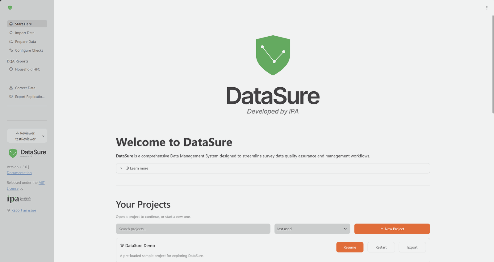{fig-alt="DataSure Start Here page with welcome header, a collapsible Learn More section, and the project selector dropdown." .lightbox}

### Command-line options

```bash
# Launch on a custom host and port
datasure --host 0.0.0.0 --port 8080

# View all available options
datasure --help
```

### Setting your reviewer name

DataSure records who made every correction, acceptance, and back check
attribution. By default, it uses your computer login. To use your own name
instead, click the **Reviewer** button near the bottom of the sidebar, which
shows the current name, and enter your name under **Reviewer name**. DataSure
saves it when you press Enter or click away, and remembers it across sessions.
Leave the box blank to go back to your computer login.

Set your reviewer name before you start correcting data, so that the Correction
Log shows who made each entry.

## Getting Familiar: Try Demo Mode First

If this is your first time using DataSure, start with Demo Mode before working
with your own data. Demo Mode loads a pre-built sample project and guides you
through all seven steps of the DataSure workflow with realistic household survey
data. It is the fastest way to understand how each part of the tool works
without any risk to real project data.

### Starting Demo Mode

1. On the **Start Here** page, select **DataSure Demo** from the project
   dropdown.
2. If you have not run the demo before, click **Start Demo**. DataSure will
   automatically load the sample datasets.
3. If you have run the demo previously, you will see two options:
   - **Resume Demo**: Continue from where you left off, including any prep
     steps, configurations, and corrections you made.
   - **Restart Demo**: Delete all demo progress and start fresh. DataSure will
     ask you to confirm before proceeding, since this cannot be undone.



### What the demo includes

Demo Mode uses two sample datasets based on a fictional household survey in
rural India:

- **demo_survey**: 132 household survey responses covering demographics, income,
  land ownership, education access, and living conditions
- **demo_backcheck**: 30 re-interview validation records matched to the survey
  data by household ID eg. `hhid`.

Both datasets contain intentional data quality issues, including missing values,
duplicate household IDs, and numeric outliers, so you can practice identifying
and correcting real problems.

### Following demo guidance

Throughout Demo Mode, look for the light blue **Learn More** boxes that appear
on each page. These boxes explain what to do at each step and why, and they
include specific instructions tailored to the demo data. DataSure expands them
by default; click to collapse them once you have read them.

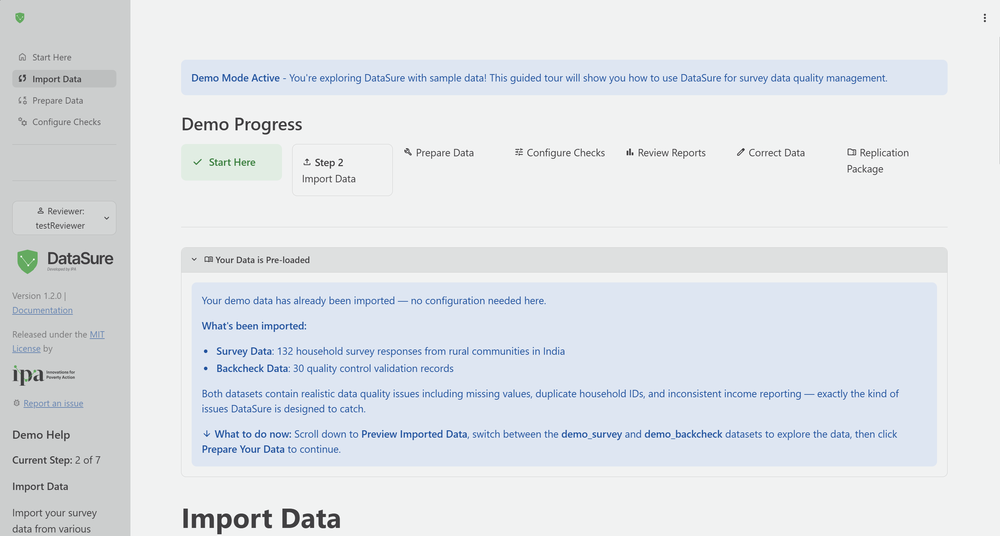{fig-alt="Expanded Learn More information box on the Configure Checks page displaying step-by-step instructions for the demo configuration." .lightbox}

The demo tracks your progress through a seven-step indicator at the top of each
page. The indicator marks completed steps, and DataSure highlights your current
step.

After completing all seven steps, DataSure will confirm that the demo is
complete and give you the option to restart the demo or end it. You can then
create your own project from the **Start Here** page.

## Step 1: Create or Open a Project

DataSure organizes each survey or data collection exercise as a **project**. A
project stores your imported datasets, configuration settings, quality check
outputs, correction history, and prep logs, all in a local cache on your
computer.

The **Start Here** page lists your projects, one row per project. Each row shows
the project name, when you last used it, and how many datasets and check pages
it has. Use the search box to find a project by name, and the sort menu to
change the order of the list.

### Creating a new project

1. On the **Start Here** page, click **+ New Project**.

2. In the **New Project** dialog, keep **Start from scratch** selected.

3. Enter a descriptive project name. Project names can contain letters, numbers,
   spaces, dashes, and underscores, and must be at least three characters long.

   Good examples: `TCAI Baseline 2026`, `Kidigo DDEP Endline 2024`,
   `ORS-Zinc Midline 2020`

4. Click **Create Project**. DataSure generates a unique project ID from the
   name, sets up the local cache folder structure, and opens the project.

To start from another project's setup instead of from scratch, see [Reusing a
project's setup](#reusing-a-projects-setup).

::: {.callout-tip}
Use one project per survey wave or data collection phase. A consistent naming
convention such as `[survey] [wave] [year]` makes it easy to manage multiple
projects over time and to hand off projects to colleagues.
:::

### Opening an existing project

On the **Start Here** page, find the project in the list and click **Open**.

### Reusing a project's setup

A **configuration file** saves a project's setup so you or a colleague can reuse
it. Use it to start the next survey round with the same checks, or to
share a working setup with another team.

The configuration file includes:

- Import sources
- Prep steps
- Check pages, with their settings and check tables
- Missing-value codes
- Corrections and back check mismatch attributions, if you choose to include
  them

The file never contains survey data, passwords, or file paths from your
computer, so you can share it by email. When you apply it, you sign in to
SurveyCTO again and select local files on the computer doing the import.

#### Export a configuration file

1. On the **Start Here** page, find the project and open its **More** menu.
2. Select **Export configuration**.
3. Choose whether to keep **Include record-level decisions (corrections and
   backcheck attribution)** ticked. DataSure ticks it by default. Untick it to
   share only the setup, for example when you start a new survey round with the same
   checks.
4. Click **Download configuration** to save the file. The file is a `.json`
   file.

#### Create a project from a configuration file

1. On the **Start Here** page, click **+ New Project**.
2. In the **New Project** dialog, select **From a configuration file**.
3. Upload the configuration file. DataSure confirms which project the file came
   from.
4. Enter a project name.
5. Click **Create Project & Continue**. DataSure creates the project and guides
   you through connecting it to your data sources.

#### Update an existing project from a configuration file

1. On the **Start Here** page, find the project and open its **More** menu.
2. Select **Update from configuration** and upload the configuration file.

When DataSure applies a configuration file to a project:

- DataSure only creates a check page if the project has no page with the same
  name and you have imported the page's dataset. DataSure lists any pages it
  skips. Existing pages keep their own settings.
- DataSure merges missing-value codes with the project's codes. If both use the
  same label, the code from the file replaces the project's code.
- DataSure applies everything in the file without asking you to confirm each
  item.

::: {.callout-note}
A configuration file exported from DataSure 1.1 does not include check tables
or missing-value codes. You can still apply it, but DataSure shows a warning,
and you need to set up those items again by hand.
:::

### Deleting a project

To permanently delete a project and all its data, open the project's **More**
menu and select **Delete project**. DataSure will ask you to confirm before
deleting. This action cannot be undone.

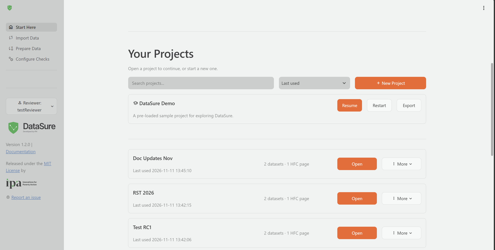{fig-alt="DataSure Start Here page titled Your Projects. At the top are a search box, a sort menu set to Last used, and a + New Project button. Below is the DataSure Demo row with Resume, Restart, and Export buttons, followed by a list of projects. Each project row shows the project name, the last-used date and time, the number of datasets and check pages, an Open button, and a More menu." .lightbox}

## Step 2: Import Data

DataSure supports 2 ways to get data into a project: connecting directly to a
SurveyCTO server, or uploading a local file. You can import multiple datasets
per project, up to 10 in total. Navigate to the **Import Data** page from the
sidebar.

### Option A: Import from SurveyCTO

Connecting to SurveyCTO is the recommended approach for active data collection.
DataSure downloads submissions incrementally, meaning it only fetches new
submissions since the last import rather than re-downloading the full dataset
each time. This saves significant time when refreshing data during active
collection.

To use SurveyCTO integration, you will need your SurveyCTO server name,
username, and password.

1. On the **Import Data** page, click the **SurveyCTO** tab.
2. Enter your server credentials:
   - **Server Name**: The prefix of your SurveyCTO server address. For example,
     if your server is `yourserver.surveycto.com`, enter only `yourserver`.
   - **Username**: Your SurveyCTO account username
   - **Password**: Your SurveyCTO account password
3. Click **Connect**. DataSure will retrieve the list of forms available on your
   server.
4. Select the form or forms you want to import.
5. If your form uses encryption, provide the **Private key**.
6. Click **Import Data**.

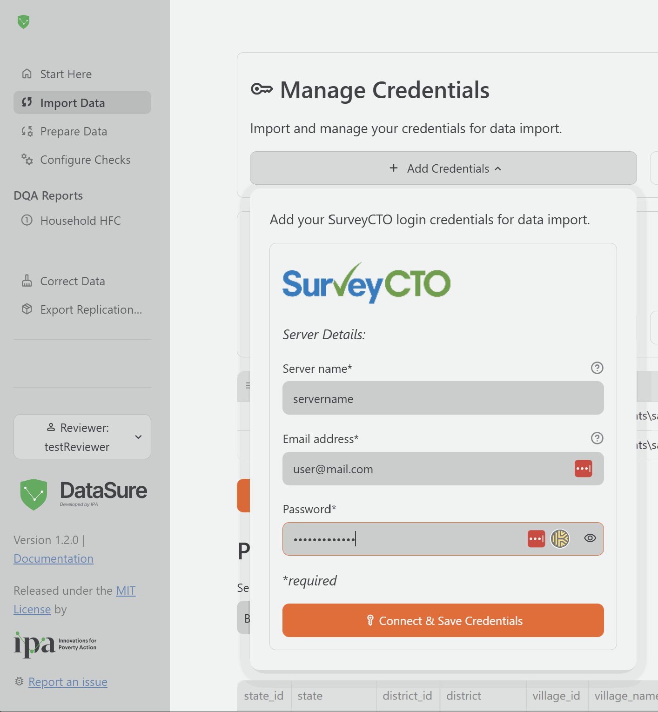{fig-alt="DataSure Import Data page with the SurveyCTO tab selected, showing server name, username, and password fields, a list of available forms to import, and the Import Data button." .lightbox}

### Option B: Upload a local file

DataSure accepts the following file formats: CSV - `.csv`, Excel - `.xlsx`,
`.xls`), Stata - `.dta`, and JSON - `.json`.

1. On the **Import Data** page, click the **Local Files** tab.

2. Drag and drop your file into the upload area, or click **Browse** to select
   it.

3. Enter a short, descriptive **alias** for the dataset. The alias is how
   DataSure refers to this dataset throughout the application, so it should be
   meaningful and consistent.

   Good examples: `survey`, `baseline_hh`, `backcheck_wave1`

4. For Excel files with multiple sheets, select the correct sheet from the
   dropdown.

5. Click **Load Data**.

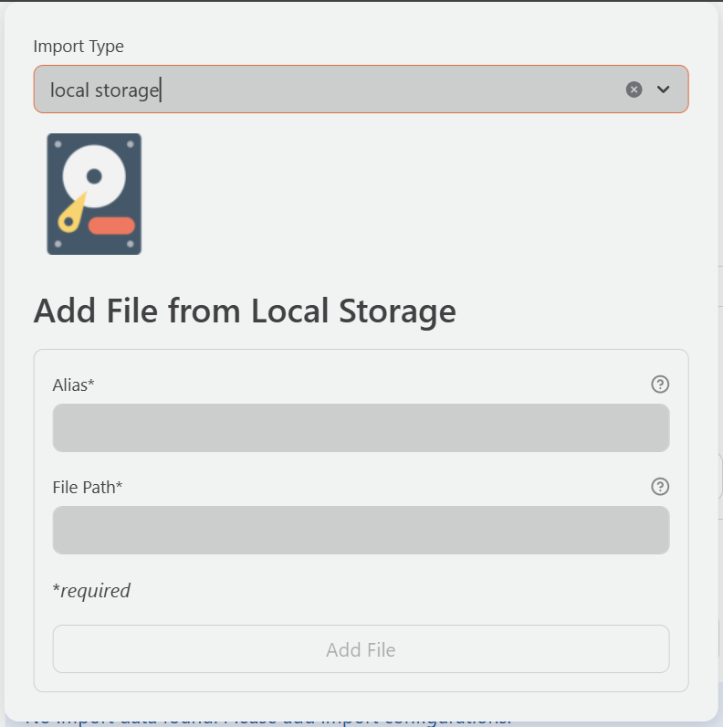{fig-alt="DataSure Import Data page with the Local Files tab selected, showing a drag-and-drop upload area with a file loaded, an alias input field, and the Load Data button." .lightbox}

### Reviewing imported data

After importing, DataSure shows a preview of your dataset with column names,
data types, row and column counts, and the first 100 rows. Review this preview
before moving on:

- Are column names what you expect?
- Do data types look correct? Dates often import as text, and you will need to
  convert them in the Prepare Data step.
- Does the row count match what you expect from your server or file?

You can return to the Import Data page at any time to refresh your data from
SurveyCTO or re-upload an updated file. DataSure will replace the existing
version of the dataset.

::: {.callout-important}
If you are running backchecks, import both your survey dataset and your
backcheck dataset before moving on. Give them distinct aliases, for example
`survey` and `backcheck`, so they are easy to identify when configuring checks.
:::

## Step 3: Prepare Your Data

The **Prepare Data** page lets you clean and transform imported datasets before
running quality checks. DataSure logs all preparation steps automatically and
later uses them to generate Stata do-files in the Replication Package. Navigate
to it from the sidebar.

Most projects need at least one preparation step: converting date columns from
text to datetime format. DataSure requires date columns to be in datetime format
for several quality check modules to function correctly.

### Why data preparation matters

SurveyCTO data is typically well-structured because the XLS form design
determines column types. Most columns arrive in the correct format and do not
require transformation. However, one common exception is **calculate fields**:
these are fields where SurveyCTO computes a value automatically - a calculated
age or a score - but stores the result as a string rather than a number. If you
need to use a calculate field in outlier detection or descriptive statistics,
you will need to convert it to numeric using the Transform Column action.

For data imported from CSV or other flat files, you may need additional
preparation, such as converting date strings to datetime format or standardizing
inconsistent text casing in ID columns.

### Available transformation functions

The **Transform Column** action supports the following functions:

  | Function                   | What it Does                                                                             | Example Use Case                                                                                                     |
  | -------------------------- | ---------------------------------------------------------------------------------------- | -------------------------------------------------------------------------------------------------------------------- |
  | **string to datetime**     | Converts a text column containing date or timestamp values into a proper datetime format | Convert `submissiondate` from `"2024-03-15 08:42:00"` to a datetime value so it works correctly in date-based checks |
  | **string to numeric**      | Converts a text column containing numbers into a numeric type                            | Convert a SurveyCTO calculate field storing a computed score as text into a number for outlier detection             |
  | **string to uppercase**    | Converts all text in a column to uppercase                                               | Standardize an ID column where enumerators entered some values as `"hh001"` and others as `"HH001"`                  |
  | **string to lowercase**    | Converts all text in a column to lowercase                                               | Normalize enumerator name entries for consistent grouping                                                            |
  | **extract pattern**        | Extracts a substring matching a regular expression from each value in a column           | Extract a district code from a composite ID field                                                                    |
  | **mathematical operation** | Applies an arithmetic operation (add, subtract, multiply, divide) to a numeric column    | Divide a duration column from milliseconds to seconds                                                                |

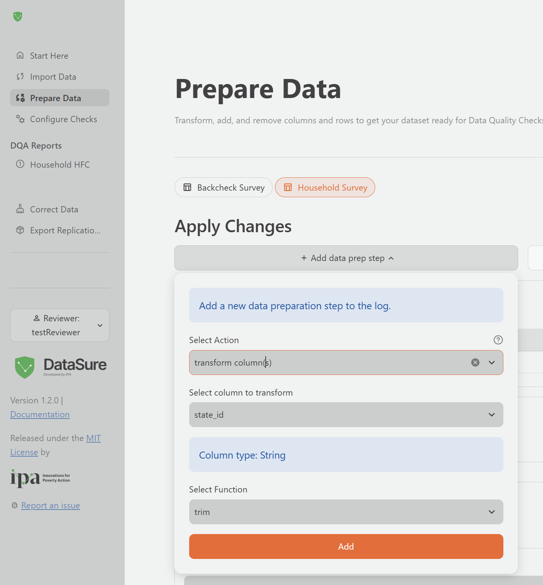{fig-alt="DataSure Prepare Data page showing the Transform Column dialog with a column selector dropdown, a function selector listing all available transformation options, and conditional parameter fields that appear based on the selected function." .lightbox}

### All available preparation actions

  | Action               | What it Does                                   | Example Use Case                                                                 |
  | -------------------- | ---------------------------------------------- | -------------------------------------------------------------------------------- |
  | **Transform Column** | Convert or modify values in an existing column | Convert `submissiondate` from text to datetime; convert `enum_name` to uppercase |
  | **Add Column**       | Create a column, including unique identifiers  | Add a UUID key column if the dataset does not have one                           |
  | **Remove Column**    | Delete a column from the dataset               | Remove PII columns not needed for quality checks                                 |
  | **Remove Row**       | Filter out rows matching a condition           | Remove test submissions or rows with a specific flag value                       |

::: {.callout-important}
If your dataset does not have a column where every row has a unique value, use
**Add Column** to create one before configuring checks. DataSure requires a
unique key column to track individual records across all quality check modules.
:::

::: {.callout-note collapse="true" title="Reference: All preparation functions"}
#### Transform Column

Use **Transform Column** to modify values in an existing column. Select a column
and a function from the dropdown. Some functions require additional parameters
that appear after you select the function.

**String functions**

  | Function           | What it Does                                                           | Example                                                                         |
  | ------------------ | ---------------------------------------------------------------------- | ------------------------------------------------------------------------------- |
  | Trim               | Remove leading and trailing whitespace from string values              | Clean up extra spaces in manually entered enumerator names                      |
  | Substring          | Extract a portion of a string by start position and length             | Extract the first 3 characters of a district code                               |
  | Replace            | Replace all occurrences of a target string with a new string           | Replace `"N/A"` with an empty string                                            |
  | Strip              | Remove all occurrences of a specified character from a string          | Strip hyphens from a formatted phone number                                     |
  | To Lowercase       | Convert all string values to lowercase                                 | Normalize enumerator name entries                                               |
  | To Uppercase       | Convert all string values to uppercase                                 | Standardize ID column values for consistent matching                            |
  | String to Number   | Convert string values to numeric                                       | Convert a calculate field stored as text to an integer or float                 |
  | String to Date     | Convert string values to date format                                   | Convert `"2024-01-15"` stored as text to a date column                          |
  | String to Datetime | Convert string values to datetime format                               | Convert `submissiondate` stored as text to a datetime column for trend analysis |
  | Extract Pattern    | Extract substrings matching a regular expression pattern               | Pull a numeric code from a compound string like `"HH-042-K"`                    |
  | Get Dummies        | One-hot encode categorical string values into binary indicator columns | Expand a `region` column into separate `region_North`, `region_South` columns   |

**Numeric functions**

  | Function       | What it Does                                         | Example                                            |
  | -------------- | ---------------------------------------------------- | -------------------------------------------------- |
  | Add            | Add a constant value to every row                    | Add an offset to correct a systematic entry error  |
  | Multiply       | Multiply every value by a constant                   | Convert a distance column from km to m             |
  | Subtract       | Subtract a constant value from every row             | Subtract a baseline offset from a numeric response |
  | Divide         | Divide every value by a constant                     | Convert `duration` from milliseconds to seconds    |
  | Round          | Round values to a specified number of decimal places | Round GPS accuracy to two decimal places           |
  | Floor          | Round values down to the nearest integer             | Truncate fractional ages to whole years            |
  | Ceiling        | Round values up to the nearest integer               | Round up partial interview counts                  |
  | Absolute Value | Replace each value with its absolute value           | Remove negative signs from response differences    |

**Datetime functions**

These functions extract a component from a datetime column and return it as a
new numeric value in the same column.

  | Function        | What it Returns                              | Example                                                          |
  | --------------- | -------------------------------------------- | ---------------------------------------------------------------- |
  | Second          | Second component (0--59)                     | Extract the seconds component from a timestamp                   |
  | Minute          | Minute component (0--59)                     | Extract the minute of submission for time-of-day analysis        |
  | Hour            | Hour component (0--23)                       | Extract submission hour to identify peak collection hours        |
  | Day of Month    | Day of the month (1--31)                     | Extract the calendar day from `submissiondate`                   |
  | Day of Week     | Day of the week (0=Monday, 6=Sunday)         | Identify which day of the week interviewers conducted interviews |
  | Day of Year     | Day of the year (1--366)                     | Calculate cumulative collection day within a year                |
  | Date            | Extract the date portion only (removes time) | Strip the time component from a datetime column                  |
  | Week of Year    | Week number within the year (1--53)          | Group submissions by collection week                             |
  | Month of Year   | Month number (1--12)                         | Extract the month of data collection                             |
  | Quarter of Year | Quarter (1--4)                               | Group submissions by quarter                                     |
  | Year            | Four-digit year                              | Extract the year from a multi-year dataset                       |

--------------------------------------------------------------------------------

#### Add Column

Use **Add Column** to create a new column in your dataset. Select a method and
configure any required parameters.

  | Method             | What it Does                                                           | Example                                                                    |
  | ------------------ | ---------------------------------------------------------------------- | -------------------------------------------------------------------------- |
  | Constant           | Add a column where every row has the same fixed value                  | Add a `country` column with value `"Kenya"` for all rows                   |
  | Sum                | Add a column with the row-wise sum of selected columns                 | Sum multiple expenditure columns into a `total_expenditure` column         |
  | Mean               | Add a column with the row-wise mean of selected columns                | Average multiple food security scores into a composite index               |
  | Median             | Add a column with the row-wise median of selected columns              | Compute the median of repeated measurement columns                         |
  | Min                | Add a column with the row-wise minimum of selected columns             | Record the lowest value across multiple numeric columns                    |
  | Max                | Add a column with the row-wise maximum of selected columns             | Record the highest value across multiple numeric columns                   |
  | Standard Deviation | Add a column with the row-wise standard deviation                      | Measure variability across repeated responses                              |
  | Variance           | Add a column with the row-wise variance                                | Compute variance across repeated measurements                              |
  | First              | Add a column with the first non-null value across selected columns     | Retrieve the first available response from a set of fallback columns       |
  | Last               | Add a column with the last non-null value across selected columns      | Retrieve the most recent value from a set of columns                       |
  | Count              | Add a column with the count of non-null values across selected columns | Count how many modules a respondent completed                              |
  | Count Unique       | Add a column with the count of unique values across selected columns   | Count distinct responses across repeated-choice columns                    |
  | Product            | Add a column with the row-wise product of selected columns             | Multiply unit price and quantity to compute total value                    |
  | Difference         | Add a column with the row-wise difference between two columns          | Compute the gap between endline and baseline scores                        |
  | Quotient           | Add a column with the row-wise quotient of two columns                 | Divide a total score by maximum possible to compute a proportion           |
  | Index              | Add a column containing the row number (0-based integer index)         | Add a row number for reference when there is no existing unique identifier |
  | UUID               | Add a column of randomly generated universally unique identifiers      | Generate a key column when the dataset has no unique row identifier        |
  | Random             | Add a column of random numbers drawn from a uniform distribution       | Generate a random assignment or sampling variable                          |

--------------------------------------------------------------------------------

#### Remove Column

Use **Remove Column** to delete one or more columns from the dataset. Select the
column or columns to remove from the list.

::::: {.callout-warning}
Removing a column is a preparation step that runs before checks. Removing a
column that you later need for check configuration will require you to delete
the step and re-add it.
:::::

--------------------------------------------------------------------------------

#### Remove Row

Use **Remove Row** to filter out rows that match a condition. Select a column, a
condition, and any required values.

**Conditions**

  | Condition                | What it Does                                                                                 | Example                                                       |
  | ------------------------ | -------------------------------------------------------------------------------------------- | ------------------------------------------------------------- |
  | Missing                  | Keep only rows where the column value is null or empty                                       | Remove rows where submission date is empty                    |
  | Not Missing              | Keep only rows where the column value is not null                                            | Remove rows where respondent ID is missing                    |
  | Equal To                 | Keep only rows where the value equals a specified value                                      | Remove rows where `is_test == 1`                              |
  | Not Equal To             | Keep only rows where the value does not equal a specified value                              | Retain only consented interviews where `consent != 0`         |
  | Greater Than             | Keep only rows where the value is greater than a threshold                                   | Remove rows where `duration > 7200` (more than 2 hours)       |
  | Less Than                | Keep only rows where the value is less than a threshold                                      | Remove rows where `duration < 60` (less than one minute)      |
  | Greater Than or Equal To | Keep only rows where the value is greater than or equal to a threshold                       | Retain rows where `age >= 18`                                 |
  | Less Than or Equal To    | Keep only rows where the value is less than or equal to a threshold                          | Remove rows where `progress_pct <= 0`                         |
  | Between                  | Keep only rows where the value falls within a specified range (inclusive)                    | Retain rows where `duration` is between 180 and 3,600 seconds |
  | Not Between              | Keep only rows where the value falls outside a specified range                               | Remove rows where `age` is not between 15 and 65              |
  | Like                     | Keep only rows where the string value matches a pattern ie. case-insensitive substring match | Remove rows where `enum_name` contains `"test"`               |
  | Not Like                 | Keep only rows where the string value does not match a pattern                               | Retain rows where `status` does not contain `"draft"`         |
:::

### Reviewing and editing preparation steps

DataSure shows all preparation steps you add in a log below the dataset preview.
Each step records the action type, the affected column, and the time you applied
it. You can review this log to confirm that DataSure applied each step
correctly.

DataSure applies preparation steps in order. If you need to remove a step, you
can delete it from the log.

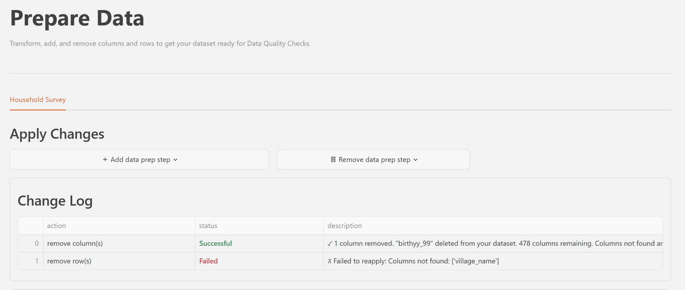{fig-alt="DataSure Prepare Data page for the Household Survey dataset. Under Apply Changes are the Add data prep step and Remove data prep step buttons. Below them, the Change Log table has three columns: action, status, and description. The first row is a step that removes columns. Its status is Successful, and its description says the step removed 1 column, birthyy_99, leaving 478 columns. The second row is a step that removes rows. Its status is Failed, and its description says the step could not be reapplied because DataSure could not find the column village_name." .lightbox}

## Step 4: Configure Quality Checks

The **Configure Checks** page is where you tell DataSure which dataset to
analyze and how the columns in your dataset map to the identifiers DataSure
needs to run its checks. Each configuration you create becomes a separate **DQA
Report** page in the sidebar.

Navigate to Configure Checks from the sidebar.

### Creating a check configuration

1. Click **Add New Check Configuration**.
2. Enter a **Page Name** for this configuration. This becomes the label for the
   DQA Report page in the sidebar. Keep it descriptive but concise, for example:
   `Household HFCs` or `Midline Survey Checks`. The name must be between 1 and
   20 characters.
3. Select your **Survey Dataset** from the dropdown. This should be the main
   survey dataset you imported.
4. Configure the column fields as described in the sections below.
5. Click **Submit** to create the configuration.

DataSure validates your inputs when you submit. If any required fields are
missing or column selections are invalid, it will show a specific error message.

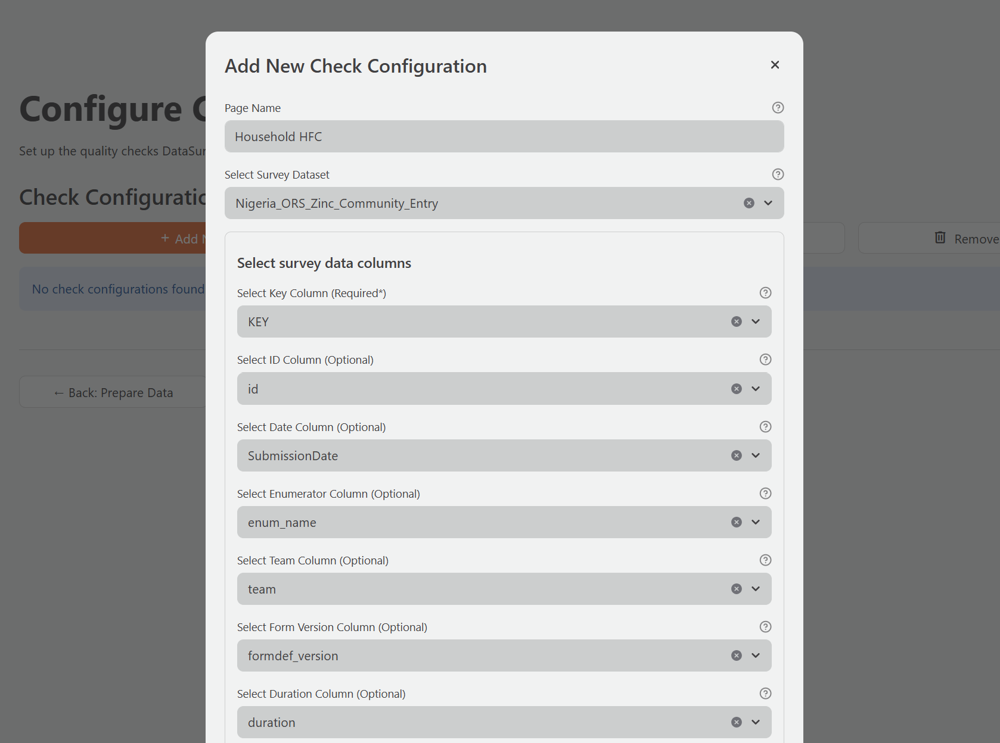{fig-alt="DataSure Configure Checks page showing the Add New Check Configuration dialog with all fields completed, including page name, survey dataset, key column, ID column, enumerator column, date column, and other optional settings." .lightbox}

### Survey columns

You must provide only the **Key Column**. All other columns are optional, but
omitting them will disable the checks that depend on them. The table below
describes each column field and which modules it affects.

  | Field                   | Required | What It Represents                                                                                                                                                              | Affected Checks                                                          | Example Values                                  |
  | ----------------------- | -------- | ------------------------------------------------------------------------------------------------------------------------------------------------------------------------------- | ------------------------------------------------------------------------ | ----------------------------------------------- |
  | **Key Column**          | Yes      | A column where every single row has a unique value. Used to identify specific records for corrections and to track flagged issues across check modules.                         | All modules                                                              | `KEY`, `uuid`, `_uuid`                          |
  | **ID Column**           | No       | The respondent identifier. May repeat if the same respondent appears in multiple rows. Without it, duplicate detection and back check matching are unavailable.                 | Duplicates, Back Checks, Survey Progress                                 | `hhid`, `respondent_id`, `hh_id`                |
  | **Enumerator Column**   | No       | Identifies the field staff member who collected each record. Without it, all enumerator-level breakdowns are unavailable.                                                       | Enumerator Stats, Missing Data (by enumerator), Outliers (by enumerator) | `enum_name`, `enumerator_id`, `interviewer`     |
  | **Date Column**         | No       | The date and time when an enumerator submitted the survey or conducted the interview. Must be in datetime format. Without it, all time-based charts and trends are unavailable. | Summary, Survey Progress, Enumerator Stats, Missing Data (over time)     | `submissiondate`, `starttime`, `date_collected` |
  | **Team Column**         | No       | Identifies the team or group the enumerator belongs to. When provided, Enumerator Stats adds team-level breakdowns alongside individual breakdowns.                             | Enumerator Stats                                                         | `team_id`, `supervisor_name`, `region_team`     |
  | **Duration Column**     | No       | The interview duration, typically in seconds. SurveyCTO records this automatically in a column called `duration`. Without it, duration statistics are unavailable.              | Enumerator Stats                                                         | `duration`, `interview_duration`                |
  | **Form Version Column** | No       | The survey form version used for each submission. SurveyCTO stores this as `formdef_version`. Without it, the Summary tab omits form version tracking.                          | Summary                                                                  | `formdef_version`, `form_version`               |
  | **Survey Target**       | No       | The expected total number of completed interviews. Without it, progress charts display submission trends but without a target reference line.                                   | Summary, Survey Progress                                                 | `200`, `500`, `1500`                            |

::: {.callout-tip}
The **Key Column** and **ID Column** serve different purposes. The Key Column
must be unique for every row, like a UUID generated per submission. The ID
Column identifies the respondent and may appear more than once if the same
person participated in multiple survey occasions.
:::

### Backcheck dataset (optional)

If you have imported a backcheck dataset, you can link it to this configuration
to enable the Back Checks module.

1. Select your **Backcheck Dataset** from the dropdown.
2. Configure the backcheck columns:

  | Field                                  | What It Represents                                                | Example Values                |
  | -------------------------------------- | ----------------------------------------------------------------- | ----------------------------- |
  | **Backcheck Date Column**              | The date of the re-interview                                      | `submissiondate`, `bc_date`   |
  | **Backchecker Column**                 | The identifier of the person conducting the re-interview          | `bcer_name`, `backchecker_id` |
  | **Backchecker Team Column** (optional) | The team the backchecker belongs to                               | `team_id`, `bc_team`          |
  | **Target Percentage** (optional)       | The target proportion of interviews to backcheck, as a percentage | `10` for 10%                  |

::: {.callout-note}
The backcheck dataset must share the same ID column as the main survey dataset
so that DataSure can match survey records to their corresponding re-interview
records.
:::

### Editing and removing configurations

To edit an existing configuration, click **Edit Check Configuration** and select
the configuration to modify. To delete a configuration, click **Remove Check
Configuration**. Removing a configuration also removes its DQA Report page from
the sidebar, but does not delete the underlying data.

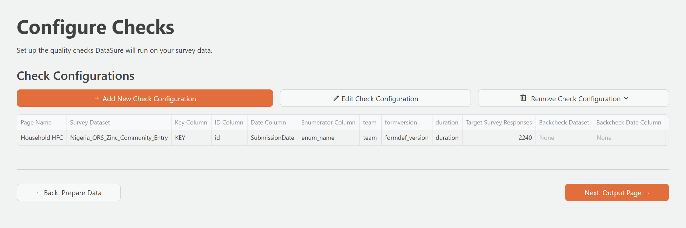{fig-alt="DataSure Configure Checks page displaying the configuration table with a saved check configuration entry and visible Edit and Remove action buttons." .lightbox}

## Step 5: Review Your DQA Reports

After saving a check configuration, a **DQA Report** page appears in the sidebar
with the name you gave the configuration. This is where you review the results
of all nine quality check modules.

Navigate to your DQA Report from the sidebar. Reports update automatically each
time you import new data. During active data collection, review them at least
once per day.

### Navigating checks

Each DQA Report page groups the nine checks into four groups. Choose a group,
then a check:

  | Group          | Checks                                                         |
  | -------------- | -------------------------------------------------------------- |
  | Overview       | Summary, Progress                                              |
  | Data integrity | Missing Values, Duplicates, Outliers & Constraints, GPS Checks |
  | Field team     | Enumerator Stats, Backchecks                                   |
  | Exploration    | Descriptive Stats                                              |

Only the check you select runs, so the page stays responsive. The page reopens
on the check you last viewed, and each check remembers its filters and sort
order. Click **Reset filters** beside a check's settings to clear them.

Each check has two sections:

- **Settings**: Configure display options and thresholds for that specific
  check. DataSure saves these settings and keeps them across sessions, so you do
  not need to reconfigure them each time.
- **Results**: The actual check output, including summary statistics, charts,
  and tables of flagged records.

Use the **Column Selector** within each check to choose which columns to include
in that check. This is useful for focusing on the variables most relevant to
your project.

### Summary tab

The Summary tab is the starting point for each monitoring session. It gives a
high-level picture of your data collection at a glance.

Key metrics shown:

- **Submission totals**: Total interviews today, this week, this month, and all
  time
- **Submission trend**: A line chart showing submissions over time, so you can
  spot slowdowns or unusual spikes
- **Progress bar**: Percentage toward your Survey Target (if configured), with
  average daily submission rate
- **Check health**: One row per check, showing its status, the issues still
  outstanding, the issues already resolved through corrections, acceptances, or
  attributions, and how they changed since yesterday or over another period you
  choose
- **Subgroup progress**: Progress broken down by a grouping variable you choose,
  such as region or enumerator team

The **Check health** section shows a status for each check:

- **No issues**: The check found nothing to review.
- **Flagged**: The check found issues to review.
- **Not set up**: The check needs columns that you have not selected yet. Click
  **Set up** to configure it.
- **Not applicable**: The check does not apply to this dataset. DataSure shows
  the reason.

Click **Open** to go to a check's results. By default, the **Change** and
**Resolved** columns compare against yesterday. To compare against another
period, expand **Comparison period**.

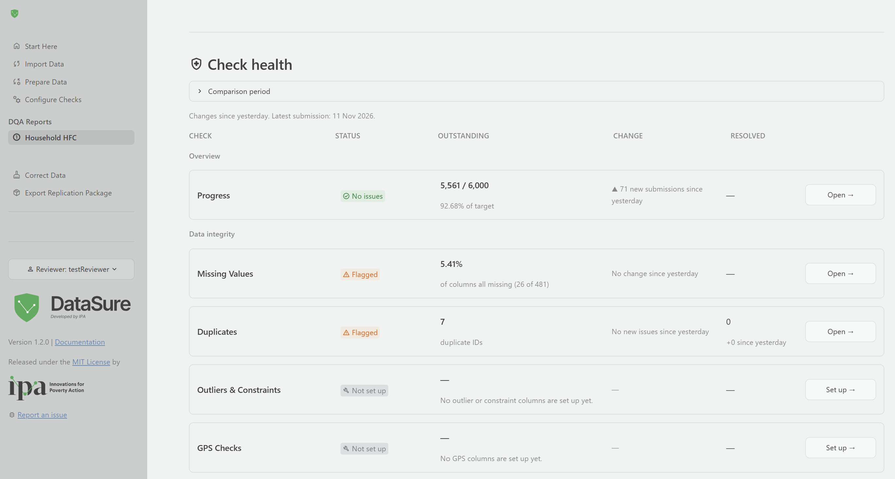{fig-alt="DataSure Check health section on the Summary tab of the Household HFC report. A note says it shows changes since yesterday. The table has the columns Check, Status, Outstanding, Change, and Resolved, grouped under Overview and Data integrity. Progress shows No issues, with 5,561 of 6,000 submissions and 71 new submissions since yesterday. Missing Values shows Flagged, with 26 of 481 columns all missing. Duplicates shows Flagged, with 7 duplicate IDs. Outliers & Constraints and GPS Checks show Not set up, each with a Set up button. The other rows have an Open button." .lightbox}

### Progress tab

The Progress tab provides a more detailed view of collection pacing. It is most
useful for project managers who need to monitor whether the team is on track to
meet the target sample size by the end of the data collection period.

Configure the tab settings before reviewing results:

- Select the **Survey ID**, **Date**, and **Enumerator** columns
- Enter the **Target Number of Interviews**
- Optionally, specify **Consent** and **Completion** columns and their expected
  values (for example, `consent = "yes"` and `completion_status = "complete"`)

The tab then shows submission trends, attempt rates per respondent, and consent
and completion rates over time.

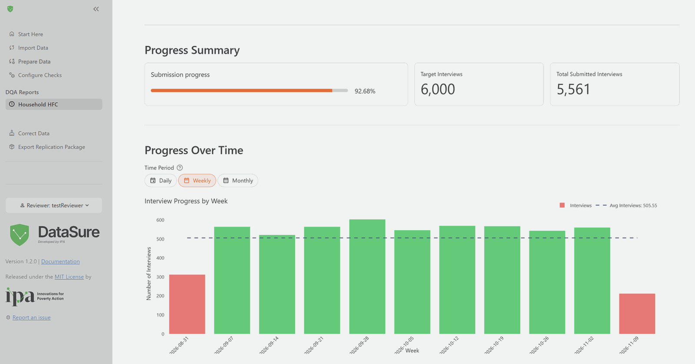{fig-alt="DataSure DQA Report Survey Progress tab displaying a cumulative submissions chart with a target reference line and a completion rate summary panel." .lightbox}

### Duplicates tab

The Duplicates tab identifies records that share the same value in columns that
should be unique.

Configure the tab settings:

- Select the **Survey ID** column (the respondent identifier to check for
  duplicates)

- Optionally add other columns to check, such as phone numbers or national ID
  numbers

- Optionally set **Records to Include** to check only the records that match a
  condition, for example `consent == Yes`. Use it to leave out a failed first
  attempt when the enumerator interviewed the respondent again under the same ID.
  The filter applies as soon as you set it.

Metrics at the top show the number of **Duplicate IDs**, the **Records
involved**, **Missing IDs**, and the number of duplicate IDs already
**Resolved** through corrections.

#### Comparing duplicate records on ID cards

DataSure shows one card for each duplicate ID. The card places the records side
by side, one column per record, and highlights the fields that differ. Use the
toggles to change what each card shows:

- **Compare all fields**: show every column, not only the key, date, enumerator,
  team, and any extra columns you selected
- **Only differing fields**: hide fields that are the same in every record

Search the cards by ID or KEY, and sort them by group size or by latest date.
Click **Download duplicates (CSV)** to export every record on the matching
cards.

If your check configuration includes a backcheck dataset, a **Survey data** /
**Backcheck data** switcher appears above the cards. The backcheck view shows
duplicate backcheck IDs, and backchecks whose ID does not appear in the survey
data (**Unmatched IDs**).

#### Resolving a duplicate ID

Investigate the duplicate first. Then, on the card, choose an action for each
record:

  | Action        | What it Does                                    | When to Use                                           |
  | ------------- | ----------------------------------------------- | ----------------------------------------------------- |
  | **Keep**      | Leaves the record and its ID unchanged          | The record holds the correct ID                       |
  | **Modify ID** | Changes the record's ID to a new ID you enter   | The enumerator entered the wrong ID                   |
  | **Drop**      | Removes the record from the dataset             | The record is a repeat submission or a test interview |

Choose a **Reason**, enter a **Note**, and click **Save**. DataSure saves every
change on the card in one step, so a card is never partly resolved. **Save**
stays disabled, with a message that explains what is missing, until:

- At most one record keeps the ID
- Every new ID is filled in, valid for the ID column, and not already used by
  another record
- You have entered a reason and a note

If you choose **Drop** for every record, DataSure asks you to confirm first,
because the ID disappears from the data. On a card for an unmatched backcheck,
you can only choose **Modify ID** or **Drop**, and the new ID must exist in the
survey data.

After you save, the card disappears and **Resolved** goes up by one. DataSure
logs each change in the Correction Log with the source `duplicates`. To undo a
change, remove it from the Correction Log on the **Correct Data** page (Step 6).

::: {.callout-note}
You cannot accept a duplicate ID as valid, because an ID must belong to one
record. If two records legitimately share an ID, such as a failed first attempt
followed by a completed interview, use **Records to Include** to leave out the
record you do not need.
:::

### Missing Values tab

The Missing Values tab shows the extent and patterns of incomplete responses
across your dataset.

Before reviewing results, configure your missing value codes:

- **Missing Labels**: Names for categories of missing responses, such as
  `Don't Know`, `Refused`, `Not Applicable`
- **Missing Codes**: The numeric codes used in the dataset to represent these
  categories, such as `-99`, `-88`, `-77`. Separate multiple codes with commas.

The tab then shows:

- Overall and per-column missing rates
- A breakdown by category (null, Don't Know, Refused, Not Applicable)
- Missing rates grouped by enumerator or other categorical variable
- Missingness over time (to detect when problems started)
- A nullity matrix: a visual grid where each row is a record and each column is
  a variable, with missing values shown in red. This is useful for spotting
  systematic patterns, such as when respondents skip an entire block of
  questions.

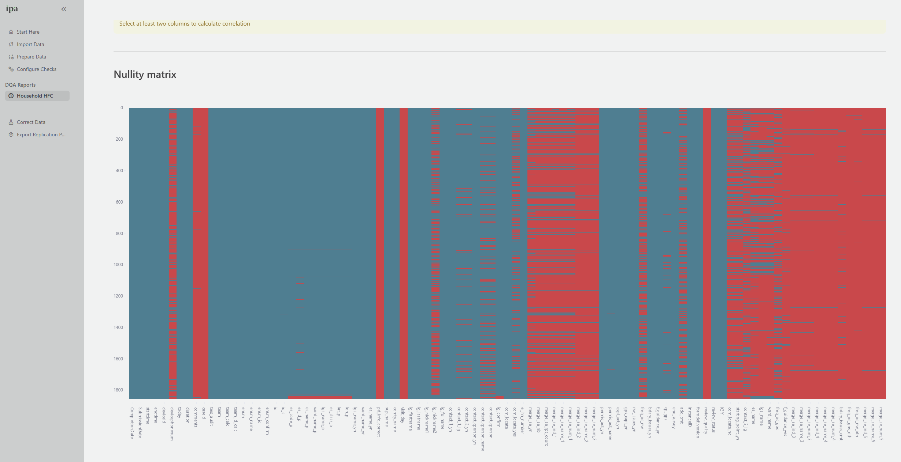{fig-alt="DataSure DQA Report Missing Data tab showing a nullity matrix grid with red blocks indicating missing values, alongside a per-column missing rate table sorted by highest missingness." .lightbox}

### Outliers & Constraints tab

The Outliers & Constraints tab flags numeric values that are statistically
unusual, and values that break the limits you set for a column. Both may
indicate data entry errors or implausible responses.

The tab requires additional setup before showing results. Click **Add
Outlier/Constraint Column** for each numeric variable you want to check:

1. **Select Columns**: Choose the column or columns to check. You can search by
   exact name or by pattern:
   - `exact`: Match specific column names, for example `land_acre`
   - `contains`: Match any column containing a substring, for example `income`
     will match `hh_income`, `farm_income`, `total_income`
   - `startswith` / `endswith`: Match by prefix or suffix
   - `regex`: Use a regular expression pattern

2. **Detection Method**: Choose how the tool identifies outliers:
   - **IQR (Interquartile Range)**: The default method. Flags values more than
     1.5 times the IQR above the 75th percentile or below the 25th percentile.
     Robust to extreme values and recommended for most survey data.
   - **Standard Deviation**: Flags values more than 3 standard deviations from
     the mean. More sensitive; suitable when the data is approximately normally
     distributed.

3. **Multiplier**: Adjust the sensitivity threshold. Lower values (for example,
   IQR multiplier of 1.0) flag more records; higher values flag fewer. Start
   with the default and adjust based on domain knowledge.

4. **Constraints** (optional): Set known limits for a variable. DataSure flags
   any value outside these limits as a constraint violation, regardless of the
   statistical threshold:
   - **Hard Min / Hard Max**: Values that are impossible, for example a negative
     land area.
   - **Soft Min / Soft Max**: Values that are possible but unlikely and need a
     follow-up, for example a respondent age above 95.

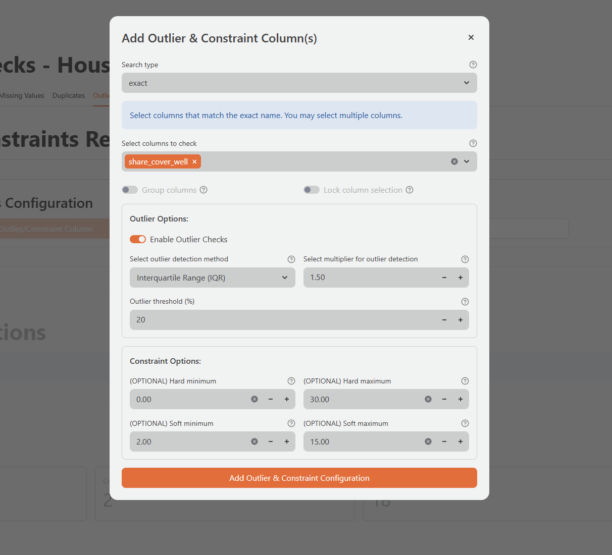{fig-alt="DataSure Outliers tab Add Outlier Column dialog with a column search field, detection method dropdown showing IQR and Standard Deviation options, a multiplier input, and optional soft minimum and maximum fields." .lightbox}

The results show a summary table with outlier counts and statistics per column,
a table of constraint violations, and a record-level table listing each flagged
value and why DataSure flagged it. Clicking on a column shows a box plot with
outliers highlighted.

#### Reviewing flagged values

Each row of the constraint violations table and the outlier inspection table
starts with a **Review** button. Click it to open a form with the record's KEY,
the column, and the current value already filled in. Choose an action, enter a
reason, and click **Apply**:

- **modify value**: Replace the value with the correct one.
- **remove value**: Set the value to missing.
- **accept**: Record that you reviewed the value and it is correct. DataSure
  hides the flag and leaves it out of the counts. The data does not change.

Accepting a value that breaks a hard limit asks you to confirm first. An
acceptance covers one check: accepting an outlier does not accept a constraint
violation on the same value. If the value changes later, the acceptance no
longer applies and DataSure flags the value again.

Use the toggles above each table to choose what it shows:

- **Show only flagged values** (on by default): Hide values that are not
  flagged. Turn it off to see every checked value, including corrected values
  that are now in range.
- **Show reviewed**: Show accepted flags and corrected values, highlighted in
  green with the reason.
- **Show only reviewed**: Show only accepted and corrected values.

DataSure logs every review in the Correction Log with the source `outliers` or
`constraints`.

### Enumerator Stats tab

The Enumerator Stats tab monitors the productivity and data quality of
individual field staff. It is one of the most actionable tabs during active data
collection because it helps you identify which enumerators need follow-up.

Configure the tab settings to map your dataset's columns to the expected fields
(Enumerator, Date, Duration, Team, etc.).

The tab shows:

- **Overview metrics**: Total enumerators, active enumerators in the past 7
  days, and submission range across enumerators
- **Enumerator summary table**: Per-enumerator statistics including total
  submissions, active days, missing value rates, mean and median interview
  duration, and consent and completion rates
- **Productivity heat map**: A grid showing how many interviews each enumerator
  completed per day. This makes it easy to spot enumerators who stopped
  submitting or whose output dropped suddenly.
- **Statistics by enumerator**: Compare any numeric column across enumerators to
  detect systematic differences in how questions were answered

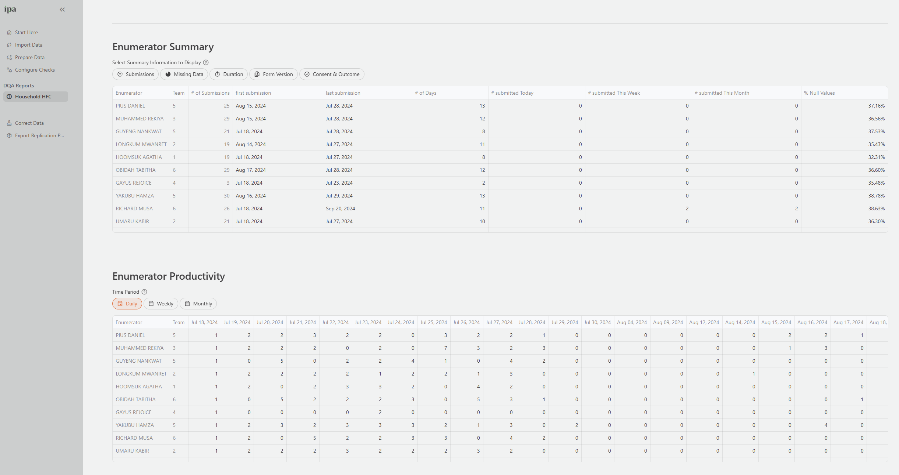{fig-alt="DataSure DQA Report Enumerator Stats tab displaying a productivity heat map grid with enumerators as rows and collection dates as columns, colored by submission count per day." .lightbox}

### GPS Checks tab

The GPS Checks tab validates geographic coordinate data.

Configure the tab to specify whether your GPS data uses separate latitude and
longitude columns or a single combined column. Optionally specify an accuracy
column (SurveyCTO stores GPS accuracy in a separate column).

The interactive map needs a Mapbox access token. You can get one free from your
[Mapbox account](https://account.mapbox.com/). Enter it under **Your Mapbox API
Key** in the GPS settings and click **Save Mapbox Token**. DataSure stores the
token securely on your computer and uses it for all your projects, so you only
need to enter it once. Without a token, the tab still lists GPS outliers but
does not show the map.

The results show:

- Total GPS records, valid coordinates, and invalid coordinates
- Accuracy statistics
- An interactive map with all interview locations plotted as markers
- A table of flagged records: missing coordinates, out-of-range values (latitude
  outside -90 to 90, longitude outside -180 to 180), and low-accuracy readings

#### Reviewing GPS outliers

Expand **View Outliers Data** to see the table of GPS outliers. Each row starts
with a **Review** button. Click it to open a form with the record's KEY,
latitude, and longitude already filled in. Choose an action, enter a reason, and
click **Apply**:

- **modify coordinates**: Enter a new latitude and longitude.
- **remove coordinates**: Clear the latitude and longitude.
- **remove observation**: Remove the record from the dataset.
- **accept**: Record that you reviewed the location and it is correct.

DataSure draws accepted points in green on the map, labels them **Accepted**,
and leaves them out of the outlier count. Turn on **Show reviewed** to list them
in the table with the reason. If either coordinate changes later, the acceptance
no longer applies and DataSure flags the point again. DataSure logs every review
in the Correction Log with the source `gps`.

::: {.callout-note}
Correcting coordinates requires separate latitude and longitude columns. If your
configuration uses a single combined GPS column, the only action available is
**remove observation**.
:::

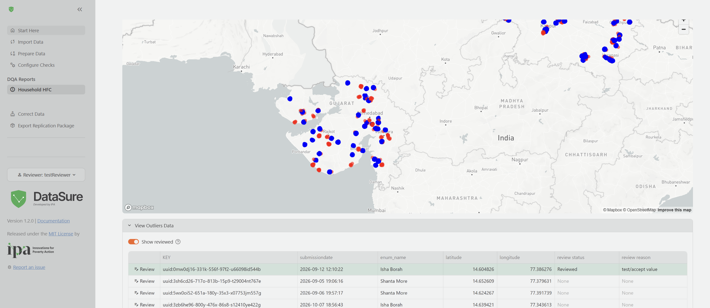{fig-alt="DataSure DQA Report GPS Checks tab displaying an interactive map with colored markers for all interview locations and outlier locations highlighted, alongside a table of flagged GPS records." .lightbox}

### Descriptive Stats tab

The Descriptive Stats tab shows distribution summaries for selected variables.
It is useful for reviewing the composition of your data and detecting unusual
distributions that might indicate collection problems, such as all respondents
reporting the same income value.

Select up to 10 columns to analyze. For each column, you can choose between:

- **One-Way Table**: Frequency distribution for a single variable
- **Two-Way Table**: Cross-tabulation with another variable
- **Summary Statistics**: Count, mean, standard deviation, min, max, and
  percentiles

### Backchecks tab

The Backchecks tab compares original survey responses against re-interview
validation data to measure enumerator reliability.

Before reviewing results, configure the tab:

1. Map the survey ID, key, enumerator, and date columns.
2. Set the **Backcheck target (%)**, the share of surveys you plan to back
   check. If you leave it blank, DataSure uses the target from the check
   configuration, or 10% if neither is set.
3. Optionally set an **Error rate target (%)**. DataSure highlights every error
   rate above it in the enumerator and backchecker statistics.
4. Optionally set an **Eligibility Filter** to count only the surveys that can
   be back checked, for example `consent` in `1`.
5. Click **Add a back check column** for each variable to validate. For each
   column, set:
   - **Category**: A grouping number (1, 2, 3) used to organize columns in the
     results table
   - **OK Range**: For numeric variables, the maximum acceptable difference
     between the original and re-interview response. For example, an OK range of
     5 for an age variable means differences of up to 5 years are not counted as
     errors.
   - **Comparison Condition**: Whether to skip comparisons when a value is
     missing in either dataset, `ignore_missing_values`, or compare all records
     including those with missing values, `compare_all`

The comparison uses the same records as the Duplicates tab: its **Records to
Include** filters apply, and DataSure leaves out records with a duplicated ID
until you resolve the duplicate. A warning above the comparison details counts
the records left out.

#### Tracking coverage against your target

The **Targets** section shows how much of your survey you have back checked:

- **Backcheck Coverage**: The share of eligible surveys that have a matching
  backcheck, compared with your target percentage.
- **Backchecks vs Expected**: The number of backchecks completed against the
  number expected. DataSure shows this only when the check configuration sets a
  survey target.

The enumerator statistics also show each enumerator's coverage, including
enumerators with no backchecks yet, and highlight coverage below the target.

#### Reading error rates

The **Error Rates** section shows the overall error rate and the error rate for
each category: the number of mismatches divided by the number of values
compared. The results also show error rates by column, by enumerator, and by
backchecker, along with a record-level table showing each comparison.

#### Attributing mismatches

Backcheck results measure how well the team collected the data, so you cannot
correct or accept a mismatch on this tab. Instead, record who caused it. Click
**Review** on a mismatch in the comparison details table and choose the error
source:

  | Error Source     | Meaning                                    | Note Required |
  | ---------------- | ------------------------------------------ | ------------- |
  | **Enumerator**   | The survey value is wrong                  | No            |
  | **Backchecker**  | The backcheck value is wrong               | Yes           |
  | **Respondent**   | The respondent gave different answers      | Yes           |
  | **Unattributed** | No source yet, or clear an earlier choice  | No            |

To attribute several mismatches at once, select their rows, then click
**Review** on one of the selected rows. The **Attribution log** below the table
lists every attribution, with who made it and when. **Mismatches Attributed** in
the summary shows the share of mismatches that have an error source.

Attribution never changes the data, the mismatch counts, or the regular error
rate. It changes only the **adjusted error rate**, which DataSure shows next to
the regular error rate for each enumerator and backchecker. The adjusted rate
leaves out the mismatches attributed to someone else, so DataSure measures each
person on their own mistakes: the enumerator adjusted rate leaves out mismatches
attributed to the backchecker or the respondent, and the backchecker adjusted
rate leaves out those attributed to the enumerator or the respondent.
Unattributed mismatches count against both. For example, an enumerator with 10
values compared and 4 mismatches, one attributed to the respondent and one to
the backchecker, has an error rate of 40% and an adjusted error rate of 20%.

## Step 6: Correct Data

The **Correct Data** page provides a structured workflow for fixing data quality
issues found in your DQA Reports. DataSure logs every correction with the
original value, new value, reason, action type, timestamp, the page that made
it, and who made it. This creates a full audit trail that DataSure also uses to
auto generate Stata do-files in the Replication Package.

### Where to make corrections

You can fix most flagged values on the check that found them, using the
**Review** buttons and duplicate ID cards described in Step 5. Use the **Correct
Data** page to correct any record, including records that no check flagged, and
to review or undo entries. Both write to the same Correction Log.

  | Where                  | What You Can Do                                                          |
  | ---------------------- | -----------------------------------------------------------------------  |
  | Outliers & Constraints | Modify value, remove value, accept                                       |
  | GPS Checks             | Modify coordinates, remove coordinates, remove observation, accept       |
  | Duplicates             | Keep, Modify ID, or Drop each record on a duplicate ID card              |
  | Backchecks             | Attribute a mismatch to its error source (the data does not change)      |
  | Correct Data page      | Modify value, remove value, remove row, for any survey record and column |

### Choosing a check page and dataset

Navigate to **Correct Data** from the sidebar. The buttons at the top of the
page list your check pages, one for each check configuration. The page opens on
the check page you last reviewed.

If the check page has a backcheck dataset, a **Survey data** / **Backcheck
data** switcher picks which dataset to correct. Each dataset has its own
Correction Log. On backcheck data, you can only modify the ID or remove a row,
because backcheck results measure data quality.

### Adding a correction

1. Click **Add correction step**.
2. Select the **Key** of the record you want to modify. This is the unique row
   identifier from the Key Column you specified in your check configuration.
3. Select the **Action**:

  | Action           | When to Use                      | Example                                                                       |
  | ---------------- | -------------------------------- | ----------------------------------------------------------------------------- |
  | **Modify Value** | Fix a specific value in a column | Correcting a typo in a household ID from `UP015-005` to `UP015-055`           |
  | **Remove Row**   | Delete an entire record          | Removing a test submission or a fully duplicated record after investigation   |
  | **Remove Value** | Set a specific value to missing  | Removing a value which should be missing if the skip pattern worked correctly |

1. Select the **Column** to modify (not required for Remove Row).

2. Enter the new value, or confirm the removal.

3. Enter a **Reason** for the correction. You must complete this field, and the
   system adds it to the permanent audit trail. Write reasons that will be
   meaningful to a future reviewer who was not present during data collection.

   Good examples:
   - `"Duplicate record confirmed with supervisor -- original submission retained, duplicate removed"`
   - `"Household ID typo confirmed via field notes -- corrected from UP015-005 to UP015-055"`
   - `"Income value of 999999 is a data entry error confirmed by enumerator -- removed"`

4. Click **Apply**.

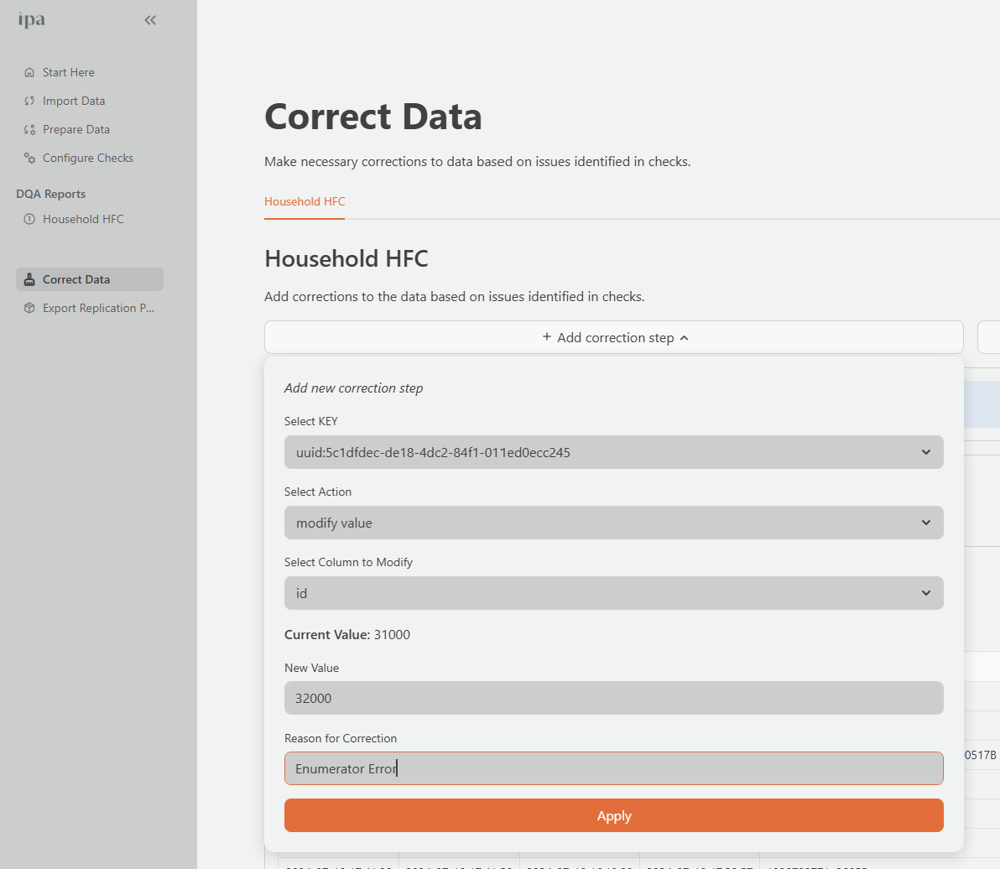{fig-alt="DataSure Correct Data page showing the Add Correction dialog with a Key selector, Action dropdown set to Modify Value, a Column selector, an auto populated Current Value field, a New Value input, and a required Reason field." .lightbox}

### Reviewing the Correction Log

The Correction Log lists every entry for the selected dataset, including the
corrections and acceptances you made on check pages. Besides the key, column,
values, action, reason, and timestamp, each entry shows:

- **Source**: The page that made the entry: `corrections_page` (the Correct Data
  page), `outliers`, `constraints`, `duplicates`, or `gps`
- **User**: Who made the entry, taken from your reviewer name (see [Setting your
  reviewer name](#setting-your-reviewer-name))
- **Status**: Whether DataSure applied the entry successfully the last time it
  loaded the data, with the reason if it did not
- **Check type**: For an accept entry, the check it applies to
- **Severity**: For an acceptance of a constraint violation past a hard limit,
  `hard`. DataSure highlights these rows in red so that a reviewer can check
  them

Use the **Source** and **Action** filters above the log to show only the entries
you need. The filters combine: for example, select the `gps` source and the
`accept` action to show only GPS acceptances.

### Undoing a correction

DataSure has no edit or undo button. To undo a correction or an acceptance,
remove its entry from the Correction Log with **Remove correction step**.
DataSure applies the remaining entries again, and any flag that the entry
resolved comes back. This is the only way to undo an entry, including entries
made on check pages.

### Verifying a correction

After applying a correction, navigate back to the relevant check and confirm the
flagged issue no longer appears. If it persists, check that you selected the
correct key and column, and that the entry's Status in the Correction Log is
`Successful`.

### Recommended correction workflow

Corrections should always follow an investigation, not precede one. Before
correcting a record, confirm the root cause.

1. Identify the issue in a DQA Report tab.
2. Investigate: is it a data entry error, a survey programming bug, or a
   legitimate extreme value?
3. Consult field notes, supervisor reports, or the enumerator directly if
   needed.
4. Apply the correction with a specific documented reason.
5. Verify the resolution in the DQA Report.
6. If the issue reflects a training or process problem, follow up with the
   enumerator to prevent recurrence.

::: {.callout-warning}
Do not remove or modify records before investigating their root cause. A
duplicate ID, for example, may be a data entry error in one record, or it may
indicate that the team surveyed a respondent twice. The correct action depends
on the investigation outcome.
:::

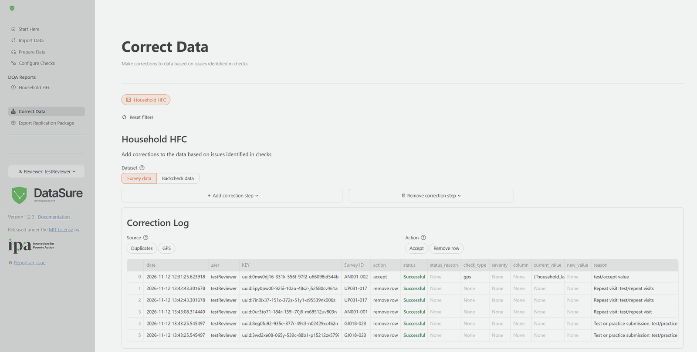{fig-alt="DataSure Correct Data page displaying the correction history table with multiple logged entries, each showing the action type, affected column, original value, new value, reason, and timestamp." .lightbox}

## Step 7: Export a Replication Package

The **Replication Package** page is the final step of the DataSure workflow. It
exports a self-contained zip file that allows anyone with Stata to reproduce
your corrected dataset exactly from the original raw source data. This supports
IPA's research transparency and data management standards.

Navigate to **Replication Package** from the sidebar.

### What the replication package contains

DataSure organizes the zip file into a structured folder layout:

```
replication_[project]_[page]/
├── 0_README.txt
├── 1_docs/
│   ├── 1_surveys/          ← SurveyCTO questionnaire (.xlsx), if applicable
│   ├── 2_codebooks/
│   └── 3_notes/
├── 2_scripts/
│   ├── 0_main.do           ← Master script that runs all others in order
│   ├── 1_install_packages.do
│   ├── 2_import_data.do    ← Imports the raw CSV into Stata
│   ├── 3_prepare_data.do   ← Applies all prep steps from the Prepare Data log
│   └── 4_corrections.do    ← Applies all corrections from the Correct Data log
├── 3_data/
│   ├── 1_raw/              ← Raw survey data as CSV
│   ├── 2_intermediate/     ← Generated when scripts are run
│   └── 3_final/            ← Generated when scripts are run
└── 4_output/
    ├── 1_tables/
    ├── 2_figures/
    └── 3_logs/
        ├── correction_log.csv
        └── prep_log.csv
```

The Stata do-files `2_import_data.do`, `3_prepare_data.do`, and
`4_corrections.do` are **auto generated** by DataSure from the preparation steps
and corrections you logged during your project. You do not need to write any
Stata code yourself. Running `0_main.do` in Stata will reproduce the full
corrected dataset from scratch.

If you imported your data from SurveyCTO, DataSure will also attempt to download
the survey questionnaire XLS file from the server and include it in the
`1_docs/1_surveys/` folder.

### Building the package

1. On the **Replication Package** page, select the **Page Name** corresponding
   to the check configuration you want to export.
2. Review the configuration details that appear below the selector to confirm
   that DataSure shows the correct dataset and key column.
3. Expand **What is inside the zip?** to preview the full directory structure
   before building.
4. If you plan to share the package outside your team, check **Exclude reviewer
   names**. DataSure leaves the User column blank in the exported
   `correction_log.csv`. The project's own Correction Log does not change.
5. Click **Build Replication Package**. DataSure assembles the package in the
   background and shows progress as it builds each component.



### Downloading the package

::: {.callout-warning title="This package contains PII"}
The replication package includes raw survey data, which may contain personally
identifiable information (PII) such as respondent names, locations, or contact
details. You must download it only to an **encrypted, access-controlled storage
location** in compliance with IPA data security and confidentiality policies. Do
not store the package on unencrypted drives, shared folders, or cloud services
not approved for confidential data.

See [IPA's Data Security
Protocol](../../data-security/data-security-protocol.qmd) for guidance on
approved storage.
:::

After the build is complete:

1. Read the PII warning.
2. Check the confirmation box to confirm you are saving to an encrypted
   location.
3. Click **Download replication package (.zip)**.

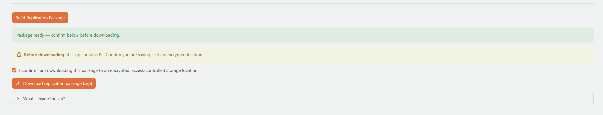{fig-alt="DataSure Replication Package page download section with the PII confirmation checkbox checked and the Download replication package zip button visible." .lightbox}

### Who should use the replication package

Use the replication package for:

- **Archiving at project closure**: Submit the package alongside your final
  dataset so that future researchers or auditors can reproduce your data
  processing pipeline.
- **Peer review and verification**: Share with a colleague or IPA's GRDS team to
  verify that the team applied corrections and prep steps correctly.
- **Handover**: If a project changes hands, the package provides a complete
  record of every decision made during data cleaning.

## Keeping DataSure Up to Date

To upgrade DataSure to the latest version, run:

```bash
uv tool upgrade datasure
```

Check the [DataSure release
notes](https://github.com/PovertyAction/datasure/blob/main/RELEASENOTES.md) for
a summary of what changed in each version before upgrading.

## Getting Help

- **GitHub Issues**: Report bugs or request features at the [DataSure
  repository](https://github.com/PovertyAction/datasure/issues)
- **Email support**: Contact IPA's Global Research and Data Science team at
  [researchsupport@poverty-action.org](mailto:researchsupport@poverty-action.org)

::: {.callout-warning title="Need Direct Support?"}
If your project needs help setting up or running DataSure, IPA's Global Research
and Data Science team provides direct technical support. Email
[researchsupport@poverty-action.org](mailto:researchsupport@poverty-action.org).
:::
