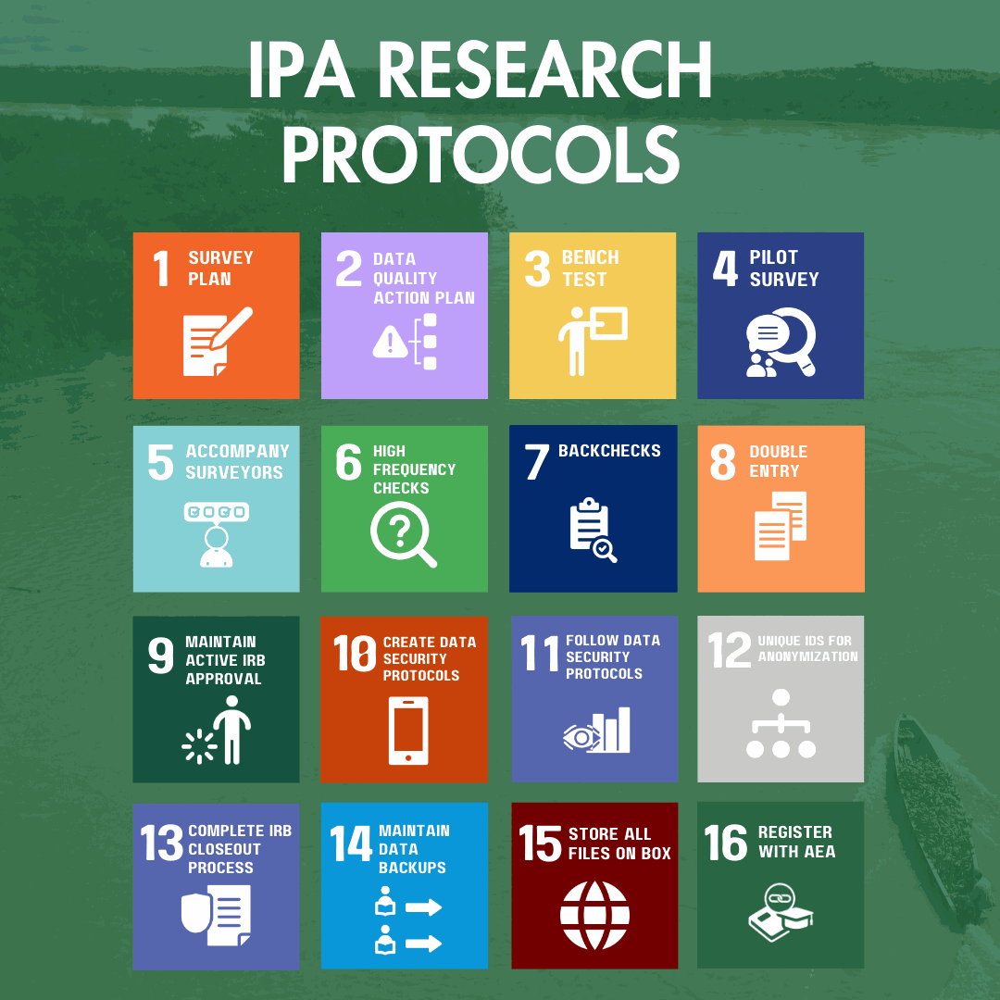

Explanation

# Data Quality and IPA Research Protocols

Every research project at IPA is required to follow IPA’s Research Protocols, also called the ‘Minimum Must Dos’ (MMDs), to ensure that IPA produces high-quality research. The protocols fall into three categories: Data Quality, Data Security and Research Ethics, and Knowledge Management and Transparency. IPA’s DataSure and Data Management System (DMS) are the standard tools for meeting them. This page maps each protocol to the Knowledge Hub guidance that helps you comply.

------------------------------------------------------------------------

## Authors

- [Niall Keleher](https://poverty-action.org/people/niall-keleher)
- [Ishmail Azindoo Baako](https://poverty-action.org/people/ishmail-azindoo-baako)

## Contributors

- [Cristhian Pulido](https://poverty-action.org/people/cristhian-pulido)
- [David Torres](https://poverty-action.org/people/david-francisco-torres-leon)

## Last Modified

- October 27, 2026

## License

- [CC BY-SA](https://creativecommons.org/licenses/by-sa/4.0/)

> **NOTE:**
>
> A summary list of IPA’s Research Protocols is also available at [poverty-action.org/research-protocols](https://poverty-action.org/research-protocols). Projects that need help meeting a protocol can contact IPA’s Global Research and Data Science team, to learn about GRDS see [GRDS Team Page](../teams/grds/).

IPA Research Protocols for High-Quality Research (® David Torres)

## Research Protocols

IPA’s Research Protocols are organized into three categories, plus the Data Management System that IPA provides to help projects meet them. Each entry below states the protocol, summarizes the requirement, and links to the Knowledge Hub page that explains how to implement it.

> **TIP:**
>
> The [IPA Data Management System (DMS)](../data-quality/data-management-system.llms.md) is not a protocol itself. It is IPA’s standard Stata and Excel toolkit for meeting the data quality protocols below, covering high frequency checks, backchecks, tracking, and progress reporting.
>
> - [IPA Data Management System (DMS)](../data-quality/data-management-system.llms.md)
> - [Guide to IPA’s Data Management System in Stata](../data-quality/how-to-dms-stata.llms.md)
> - [DataSure](../data-quality/datasure/index.llms.md): IPA’s dashboard for running the DMS checks without writing Stata code
> - `ipacheck` (high frequency checks) and `bcstats` (backcheck comparisons) are the Stata programs behind the DMS. See [High Frequency Checks](../data-quality/high-frequency-checks.llms.md) and [Backchecks](../data-quality/backchecks.llms.md).

> **TIP:**
>
> 1.  **Create survey plan before launch.** An operational plan covering timelines, staffing, logistics, and procurement for every survey stage, aligned with the project budget. See [Survey Planning](../data-quality/survey-plan.llms.md).
> 2.  **Create data quality assurance plan and materials before launch.** Set out requirements for backchecks, high frequency checks, accompaniments, spot checks, data flow, roles, reporting schedules, and triggered actions. See [Data Quality Action Plan](../data-quality/action-plan.llms.md).
> 3.  **Bench test survey (ideally at least two weeks in advance).** Test the programmed survey in the office with at least three different testers, and re-test after every change. See [Bench Testing](../data-quality/bench-testing.llms.md).
> 4.  **Pilot survey (ideally at least one week in advance).** Pilot every survey in communities outside the study sample, as close to real surveying as possible, including devices and data flow. See [Pilot Survey](../data-quality/pilot-survey.llms.md).
> 5.  **Accompany surveyors in first week of survey.** Field supervisors must personally accompany every field officer at least once during the first week, then scale down. See [Accompany Surveyors](../data-quality/accompany-surveyors.llms.md).
> 6.  **Implement and act on high frequency checks.** Run frequent checks on surveyor performance, ethics compliance, outliers, duplicates, and project-specific issues, with clear roles and triggered actions. See [High Frequency Checks](../data-quality/high-frequency-checks.llms.md).
> 7.  **Implement and act on backchecks.** Re-interview a random subset of respondents with a qualified backchecker, compare answers, and act on discrepancies. See [Backchecks](../data-quality/backchecks.llms.md).
> 8.  **Double enter and reconcile paper surveys.** If collecting paper surveys, two independent operators must enter each; a third reconciles discrepancies against the original. See [Data Integrity: Double Entry](../data-quality/data-integrity.llms.md#double-entry).

> **TIP:**
>
> 1.  **Maintain IRB approval throughout project lifecycle.** Cover initial approval, renewals, amendments, unexpected event reports, and current human subjects certificates for everyone who can see PII. See [The IRB Lifecycle](../research-ethics/irb-lifecycle.llms.md).
> 2.  **Create data security plan and set up encryption before launch.** Respondent data must be encrypted at every stage from the moment of collection: device, transmission, server, cloud storage, laptops, and removable media. See [Data Security Protocol](../data-security/data-security-protocol.llms.md).
> 3.  **Maintain data security plan throughout project lifecycle.** Keep PII encrypted in storage and transit, and restrict passwords to essential IRB research staff. See [How to Implement Data Security Protocols](../data-security/how-to-data-security.llms.md).
> 4.  **Use new UID in deidentified dataset.** Before sharing or publishing unencrypted data, remove all identifying information and replace the original unique identifier with a new one. See [Data Anonymization](../data-quality/data-anonymization.llms.md).
> 5.  **Retire your project with all IRBs once the project is complete.** Close out with every reviewing IRB once interventions are finished and you no longer actively work with identified data. See [The IRB Lifecycle: Closure](../research-ethics/irb-lifecycle.llms.md#closure).

> **TIP:**
>
> 1.  **Back up data in at least two locations.** Keep at least two copies at all times, for example the SurveyCTO server plus a laptop synced to Box. Never delete server data until it has fully synced. See [Data Integrity: Maintaining Data Backups](../data-quality/data-integrity.llms.md#maintaining-data-backups).
> 2.  **Save all project files to long-term storage.** Store raw data, questionnaires, manuals, logs, high frequency check files, do-files, IRB documents, and replication code in the designated long-term storage following common folder structure. See [Data Integrity: Storing Files on Box](../data-quality/data-integrity.llms.md#storing-files-on-box) for an example.
> 3.  **Register project with AEA.** Register every IPA study in the American Economic Association’s RCT Registry. A pre-analysis plan is not required. See [AEA RCT Registry](../data-quality/aea-registry.llms.md).

## Putting the Protocols into Practice

The protocols apply whether you hire your own surveyors or contract a survey firm. A firm may carry out some steps, but IPA staff remain responsible for verifying that each protocol is followed and for maintaining oversight of the quality assurance process.

Implementing these steps visibly and early tells the survey team that high quality data is the top priority. Showing surveyors from the start that you and your monitors will run high frequency checks, backchecks, and accompaniments helps prevent falsified surveys and reinforces adherence to field procedures. Quality control can create tension with survey teams. You can reduce it by explaining that while you trust them, you must be able to demonstrate to the outside world that you took every step to obtain the highest possible quality of data. These measures also reveal strengths and weaknesses among surveyors, so the leadership team can give targeted feedback and training.

### Your Presence in the Field

As a team leader, spend time with your surveyors, especially at the beginning of the survey period. Direct presence helps ensure surveyors conduct surveys correctly, lets you observe how respondents understand questions, and helps you learn about the community you are collecting data from. High frequency checks, backchecks, and accompaniments then give you confidence in data quality for the rest of the survey period.

Back to top
